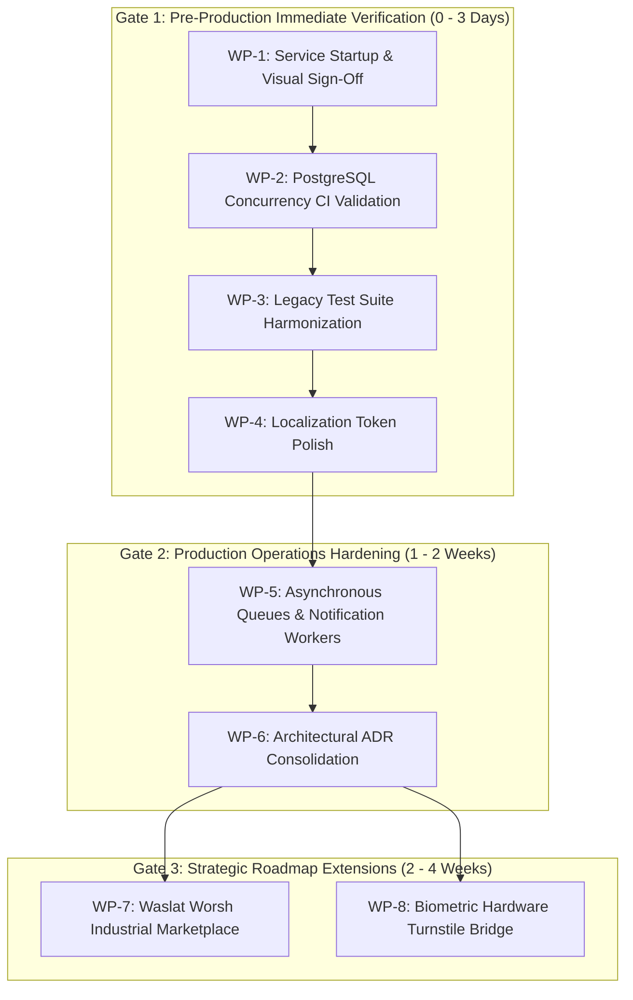

# GarmentOS Cloud — Remaining Project Work & Execution Roadmap

**Date:** October 31, 2026  
**Target Milestone:** Production Commercial Release v1.0.0 & Future Roadmap Completion  
**Execution Context:** Dependency-Ordered Master Plan

---

## 1. Master Dependency Sequence



---

## 2. Detailed Work Packages (In Dependency Order)

### Work Package 1: Service Startup & Live Visual Sign-Off
- **Classification:** **Immediate Blocker (Release Gate)**
- **Dependency:** None (Services currently stopped)
- **Objective:** Launch local services, execute browser-based inspections across the 4 visual quadrants (Arabic/English × Light/Dark), and capture screenshot evidence.
- **Tasks:**
  1. Await owner approval and execute:
     - `cd apps/api && php artisan serve --port=8000`
     - `cd apps/web && npm run dev`
  2. Inspect representative screens (Dashboard, Warehouses, Purchasing, Cutting Room, Bundles QR, Sales POS, Financial Statements, HR Payroll, CMT Subcontracting, Platform Admin).
  3. Validate RTL/LTR transitions, modal responsiveness, table overflow, and theme toggling.
- **Estimated Effort:** 0.5 Engineering Days
- **Priority:** P0 (Highest)

---

### Work Package 2: PostgreSQL Concurrency & Row-Locking CI Validation
- **Classification:** **Immediate Blocker (Database Gate)**
- **Dependency:** Docker / Local PostgreSQL 16 Daemon
- **Objective:** Execute the 5 skipped concurrency and row-locking tests in `PostgresConcurrencyIntegrationTest` to verify ACID isolation and deadlock-free operation.
- **Tasks:**
  1. Launch PostgreSQL 16 container:
     ```powershell
     docker run --name garmentos-postgres -e POSTGRES_DB=garmentos_test -e POSTGRES_USER=garmentos -e POSTGRES_PASSWORD=secret_test_password -p 5432:5432 -d postgres:16-alpine
     ```
  2. Run PostgreSQL migrations:
     ```powershell
     cd apps/api && php artisan migrate --database=pgsql
     ```
  3. Run concurrency test suite:
     ```powershell
     php artisan test --filter PostgresConcurrencyIntegrationTest
     ```
  4. Verify that simultaneous POS checkout, concurrent stock deduction, and simultaneous bundle scans operate cleanly with zero deadlocks.
- **Estimated Effort:** 0.5 Engineering Days
- **Priority:** P0 (Highest)

---

### Work Package 3: Legacy Test Suite Harmonization
- **Classification:** **Quality & CI Health**
- **Dependency:** Work Package 2
- **Objective:** Eliminate the 3 legacy test failures in `SecurityRegressionDay3Test`, `BusinessModulesPhases7to10Test`, and `EndToEndBusinessJourneysTest`.
- **Tasks:**
  1. Update `SecurityRegressionDay3Test.php:411` assertion from `assertStatus(500)` to `assertStatus(422)` to match approved DEF-01 graceful error handling.
  2. Update `BusinessModulesPhases7to10Test.php:369` and `EndToEndBusinessJourneysTest.php:578` to approve the test piece-work logs prior to calling `generatePayroll()`, matching Phase C governance rules.
  3. Verify a completely green test runner: `php artisan test` -> **295/295 tests passing**.
- **Estimated Effort:** 0.5 Engineering Days
- **Priority:** P1 (High)

---

### Work Package 4: Localization Token Polish (LOC-01 to LOC-12)
- **Classification:** **User Experience**
- **Dependency:** None
- **Objective:** Refine the 12 confirmed remaining Arabic-in-English tokens detected during the bidirectional audit.
- **Tasks:**
  1. `FinancialReportsView.tsx`: Replace 14 instances of `<span ...>ج.م</span>` with `{isAr ? 'ج.م' : 'EGP'}`.
  2. `PublicWebsite.tsx`: Wrap stat numbers `0 خلط` and `100% آلي` in `{isAr ? ... : ...}` ternaries.
  3. `FeaturePages.tsx`: Localize the 4 CMT step headers (`1. إذن استلام أمانة`, etc.).
  4. `InfoPages.tsx`: Localize the 3 architectural pillar list items.
  5. `WarehouseManagerTab.tsx`: Localize units (`جم/م²`, `عرض:`, `م`, `ثوب`) and fallback `'عام'` -> `'General'`.
  6. `HrTab.tsx`: Localize overtime unit `س` -> `h`.
  7. `AccountingTab.tsx`: Localize template literal currency suffixes `+... ج.م` -> `+... EGP`.
  8. `PublicStorefrontView.tsx` & `PublicOrderTracker.tsx`: Ensure fallback currency defaults to `{isAr ? 'ج.م' : 'EGP'}`.
  9. Run `npm run build` to verify 0 errors.
- **Estimated Effort:** 1.0 Engineering Day
- **Priority:** P1 (High)

---

### Work Package 5: Asynchronous Queues & Background Workers
- **Classification:** **Production Scalability**
- **Dependency:** Redis / Database Queue
- **Objective:** Decouple long-running reporting, webhooks, and notifications from synchronous HTTP requests.
- **Tasks:**
  1. Configure Redis / Database queue driver in `.env` and `config/queue.php`.
  2. Create job handlers in `apps/api/app/Jobs/`:
     - `ProcessFinancialReportExportJob`: Generates large CSV / Excel reports in background.
     - `ProcessPaymentWebhookJob`: Asynchronously validates and records Stripe/Paymob webhooks.
     - `DispatchCustomerOrderNotificationJob`: Sends order confirmation notifications.
  3. Implement supervisor / systemd configuration for queue workers (`php artisan queue:work`).
- **Estimated Effort:** 3.0 Engineering Days
- **Priority:** P2 (Medium)

---

### Work Package 6: Architectural ADR Consolidation
- **Classification:** **Documentation Integrity**
- **Dependency:** None
- **Objective:** Formalize the monorepo folder structure changes versus original roadmap ADR-001.
- **Tasks:**
  1. Draft and record **ADR-015: Monorepo Frontend Package Consolidation** in `docs/DECISIONS.md`.
  2. Document that `apps/storefront` was incorporated as a distinct routed view (`#/store/:tenantSlug`) inside `apps/web` to eliminate dual-Vite bundling overhead and share design system components directly.
  3. Document that `packages/ui` was positioned directly in `apps/web/src/components/ui/` for streamlined rapid deployment.
- **Estimated Effort:** 0.5 Engineering Days
- **Priority:** P2 (Medium)

---

### Work Package 7: Waslat Worsh Industrial Marketplace (Phase G)
- **Classification:** **Strategic Expansion (Post-Launch)**
- **Dependency:** Phase 06 (Subcontracting & CMT)
- **Objective:** Build the B2B marketplace allowing garment factories to publish cut-and-make RFQs and award jobs to independent workshops.
- **Tasks:**
  1. **Database Schema:** Create `workshop_profiles`, `rfqs`, `rfq_bids`, `rfq_attachments` tables.
  2. **Backend API:**
     - `RfqController`: CRUD for RFQs, status lifecycle (`draft`, `open_for_bidding`, `awarded`, `closed`).
     - `WorkshopProfileController`: Workshop machinery profile, daily cutting capacity, past ratings.
     - `RfqBidController`: Workshop bidding on unit piece rates and delivery schedules.
     - `WaslatWorshService`: Converts accepted bids directly into `JobOrder` records via `SubcontractingService`.
  3. **Frontend Views:**
     - Workshop directory and filtering.
     - RFQ publication wizard with fabric specifications and target quantity.
     - Bidding comparison table with price and turnaround ranking.
  4. **Automated Testing:** Integration test suite verifying bid acceptance, tenant isolation, and conversion to `JobOrder`.
- **Estimated Effort:** 10.0 Engineering Days
- **Priority:** P3 (Future Roadmap)

---

### Work Package 8: Biometric Hardware IoT Bridge
- **Classification:** **Optional On-Premise Integration**
- **Dependency:** Phase 09 / Phase C (HR & Attendance)
- **Objective:** Provide a lightweight daemon to bridge on-premise fingerprint/facial biometric clocks with GarmentOS Cloud.
- **Tasks:**
  1. Develop Python / Go background agent with ZKTeco pyzk SDK.
  2. Poll hardware logs periodically, deduplicate punch records, and push to `/api/v1/hr/attendances` using factory API credentials.
  3. Provide offline caching in SQLite if factory internet drops.
- **Estimated Effort:** 3.0 Engineering Days
- **Priority:** P3 (Optional)

---

## 3. Summary of Total Effort & Milestones

| Milestone | Scope Included | Total Effort | Target Status |
|:---|:---|:---:|:---:|
| **Milestone 1: Commercial Pilot Release (MVP)** | WP-1, WP-2, WP-3, WP-4 | **2.5 Days** | 🚀 **PILOT READY** |
| **Milestone 2: Enterprise Production Release** | WP-5, WP-6 | **3.5 Days** | 🏆 **PRODUCTION READY** |
| **Milestone 3: Complete Roadmap Full Scope** | WP-7, WP-8 | **13.0 Days** | 🌟 **FULL ROADMAP COMPLETE** |

