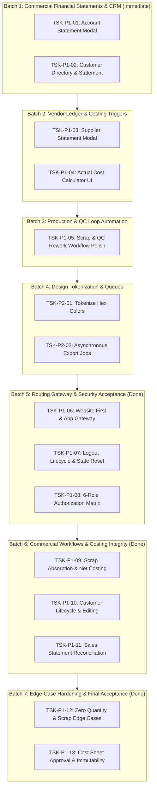

# GarmentOS Cloud — Accelerated Delivery Board
**Document Version:** 1.0.0  
**Effective Date:** November 1, 2026  
**Engineering Directive:** CTO Accelerated Delivery Execution — Complete, Implement, Test, Repeat  
**Repository:** `c:\Users\HP\Downloads\clothes`  
**Current Git State:** Branch `main` (`e9215d2`) — Working tree modifications preserved  

---

## 1. Executive Mission & Delivery Strategy

This delivery board governs the accelerated implementation phase of **GarmentOS Cloud**. The platform's architectural foundation, core multi-tenancy, RBAC, and basic ERP domains are functional. This board identifies and schedules every incomplete page, disconnected action, missing API integration, and workflow bridge required for full commercial delivery.

### Execution Principles:
1. **Implementation over Audit:** Direct execution of production code in small, testable batches.
2. **End-to-End Real Persistence:** Zero mock data, zero simulated successes, zero fake alerts.
3. **Fail-Closed Security:** Strict `tenant_id` scoping, Sanctum token authentication, and role authorization.
4. **Bilingual & Responsive:** Full Arabic (RTL) and English (LTR) with light and dark mode support.
5. **Continuous Verification:** Every batch must verify backend tests (`php artisan test`) and frontend compilation (`npm run build`).

---

## 2. Priority Classification Scheme

- **P0 — Critical Integrity & Security:** Data integrity, authorization leaks, crashes, and high-concurrency race conditions.
- **P1 — Core Commercial Scope & Required Pages:** Essential ERP, CRM, procurement, production, accounting, and marketplace pages/features currently missing or disconnected.
- **P2 — UX Polish, Reporting & Automation:** Design system tokenization (eliminating remaining raw hex colors), automated background queue dispatchers, and batch export flows.
- **P3 — Future Enhancements:** Non-blocking modular extensions, state registry refactoring, and on-premise hardware bridges.

---

## 3. Master Task Delivery Matrix

| Task ID | Pri | Module / Page | Feature / Missing Behavior | Status | Assigned Batch |
|---|---|---|---|---|---|
| **TSK-P1-01** | **P1** | **Accounting** | **Account Statement & Interactive Ledger Modal** (`AccountStatementModal`): Replace alert placeholder with real journal lines, running balance, and CSV/PDF export. | **ACCEPTED** | **Batch 1 (Done)** |
| **TSK-P1-02** | **P1** | **Sales & CRM** | **Customer Directory & Statement Ledger** (`CustomerController`, `CustomerStatementModal`): Add `/api/v1/customers` endpoints, statement ledger, and customer management tab in `SalesTab.tsx`. | **ACCEPTED** | **Batch 1 (Done)** |
| **TSK-P1-03** | **P1** | **Procurement** | **Supplier Account Statement & History Modal** (`SupplierStatementModal`): Add `/api/v1/suppliers/{id}/statement` endpoint, transaction ledger (PO, GRN, Invoices, payments) in Purchasing. | **ACCEPTED** | **Batch 2 (Done)** |
| **TSK-P1-04** | **P1** | **Costing** | **Interactive Production Order Cost Calculator UI** (`CalculateCostModal.tsx`): Production order selector, real-time material/labor/overhead breakdown, and cost-sheet persistence. | **ACCEPTED** | **Batch 5 (Done)** |
| **TSK-P1-05** | **P1** | **Production & QC** | **Bundle Scrap & QC Rework Workflow Polish**: Enable automatic bundle status updates and inventory scrap adjustments upon inspection rejection. | **ACCEPTED** | **Batch 3 (Done)** |
| **TSK-P1-06** | **P1** | **Routing** | **Runtime Routing Acceptance & URL Gateway**: Public website first, `/app` entry, role dashboard routing, and unauthenticated route interception. | **ACCEPTED** | **Batch 5 (Done)** |
| **TSK-P1-07** | **P1** | **Auth Security** | **Logout Lifecycle & Confirmation Dialog**: Visible desktop/mobile controls, bilingual confirmation modal, POST `/api/v1/auth/logout` token revocation, and state purging. | **ACCEPTED** | **Batch 5 (Done)** |
| **TSK-P1-08** | **P1** | **RBAC** | **Role & Tenant Isolation Verification**: Automated tests for 6 roles (`company_owner`, `production_manager`, `accountant`, `worker`, `sales_rep`, `platform_admin`) and module guarding. | **ACCEPTED** | **Batch 5 (Done)** |
| **TSK-P1-09** | **P1** | **Costing** | **Production Costing Integrity & Scrap Absorption**: Net inventory transactions, approved/settled piece-work labor, historical lock protection, scrap unit-cost absorption, audit logging. | **ACCEPTED** | **Batch 6 (Done)** |
| **TSK-P1-10** | **P1** | **Sales & CRM** | **Customer Editing & Credit Limit Management**: Full customer update modal (`CreateCustomerModal` in edit mode), pencil action in customer directory, credit limit support. | **ACCEPTED** | **Batch 6 (Done)** |
| **TSK-P1-11** | **P1** | **Commercial Sales** | **Sales Reconciliation & Customer Statement**: Verified end-to-end sales orders, invoices, payments, and statement ledger balance reconciliation. | **ACCEPTED** | **Batch 6 (Done)** |
| **TSK-P1-12** | **P1** | **Costing Edge Cases** | **Zero Good Quantity & Fully Scrapped Order Protection**: Prevent division-by-zero, block fabricated unit costs on zero accepted pieces, stop scrap/rework double counting. | **ACCEPTED** | **Batch 7 (Done)** |
| **TSK-P1-13** | **P1** | **Costing Lifecycle** | **Cost Sheet Approval & Idempotent Lock**: API and UI lifecycle (`POST /api/v1/accounting/cost-sheets/{id}/approve`), status badges, audit logging, and historical sheet preservation. | **ACCEPTED** | **Batch 7 (Done)** |
| **TSK-P0-01** | **P0** | **Infrastructure** | **PostgreSQL Concurrency Test Execution**: Standby until PostgreSQL 15+ daemon is active on staging. | **BLOCKED (ENV)** | **Post-Pilot** |
| **TSK-P2-01** | **P2** | **Design System** | **Legacy Hex Color Tokenization**: Refactor remaining 155 `#7F1625` / `#460809` occurrences to semantic CSS tokens. | **ACCEPTED** | **Batch 4 (Done)** |
| **TSK-P2-02** | **P2** | **Asynchronous Ops** | **Export & Webhook Queue Worker Jobs**: Dispatch large report generation and webhooks via background queue workers. | **ACCEPTED** | **Batch 4 (Done)** |
| **TSK-P3-01** | **P3** | **Architecture** | **Monolithic Modal State Refactoring**: Migrate 73 modal states in `App.tsx` into `useModalRegistry`. | **NOT STARTED** | **Future Sprint** |

---

## 4. Detailed Engineering Task Specifications

### TSK-P1-01: Account Statement & Interactive Ledger Modal
- **Page / Module:** Accounting (`AccountingTab.tsx`, Chart of Accounts view).
- **Exact Missing Behavior:** In `AccountingTab.tsx` (line 507), clicking "كشف حركة الحساب" (Account Ledger) triggers an inline `alert()` displaying only account code and balance. It must open a full interactive modal showing the transaction history, date, reference, description, debit, credit, and running balance.
- **Frontend Files:**
  - `apps/web/src/components/accounting/AccountStatementModal.tsx` (New)
  - `apps/web/src/components/accounting/AccountingTab.tsx` (Modified)
  - `apps/web/src/api/client.ts` (Modified)
- **Backend / API Files:**
  - `apps/api/app/Http/Controllers/Api/AccountingController.php` (Add `accountStatement` method)
  - `apps/api/routes/api.php` (`GET /api/v1/accounting/accounts/{id}/statement`)
- **Database Impact:** None (Read-only query against `chart_of_accounts`, `journal_entries`, and `journal_entry_lines`).
- **Dependencies:** Workflow 15 (General Ledger).
- **Acceptance Criteria:**
  - Clicking "كشف حركة الحساب" opens `AccountStatementModal`.
  - Shows account code, name, category, opening balance, and live current balance.
  - Lists journal lines sorted chronologically with dynamic running balance calculation.
  - Bilingual (Arabic/English) and theme-aware (light/dark).
  - Includes Print and CSV export actions.
- **Effort Estimate:** 0.5 Engineering Days.
- **Test Evidence:** Feature test in `AccountingFeatureTest.php`.

---

### TSK-P1-02: Customer Directory & Account Statement Ledger
- **Page / Module:** Sales & CRM (`SalesTab.tsx`, `App.tsx`).
- **Exact Missing Behavior:** Sales orders currently accept unverified customer names as raw text strings. There is no dedicated `/api/v1/customers` endpoint for sales (only subcontracting), no customer directory in `SalesTab.tsx`, and no customer account statement ledger showing order history, invoices, payments, and credit returns.
- **Frontend Files:**
  - `apps/web/src/components/sales/CustomerStatementModal.tsx` (New)
  - `apps/web/src/components/sales/CreateCustomerModal.tsx` (New)
  - `apps/web/src/components/sales/SalesTab.tsx` (Add `customers` sub-tab)
  - `apps/web/src/api/client.ts` (Add `api.customers` module)
- **Backend / API Files:**
  - `apps/api/app/Http/Controllers/Api/CustomerController.php` (New)
  - `apps/api/routes/api.php` (`GET/POST /api/v1/customers`, `GET /api/v1/customers/{id}/statement`)
- **Database Impact:** Utilizes existing `customers` table created in migration `2026_10_15_000007`. Scoped strictly to `tenant_id`.
- **Dependencies:** Workflow 13 (Sales & POS), Workflow 14 (Customers).
- **Acceptance Criteria:**
  - `GET /api/v1/customers` returns paginated customers with calculated current balance.
  - `POST /api/v1/customers` creates customer with unique code per tenant.
  - `GET /api/v1/customers/{id}/statement` returns invoice and payment history.
  - `SalesTab.tsx` has a dedicated "العملاء" (Customers) sub-tab.
  - Sales order modal allows selecting registered customers.
  - Clicking customer opens `CustomerStatementModal`.
- **Effort Estimate:** 1.0 Engineering Days.
- **Test Evidence:** `CustomerManagementAndStatementTest.php`.

---

### TSK-P1-03: Supplier Account Statement & History Modal
- **Page / Module:** Procurement (`App.tsx`, Purchasing view).
- **Exact Missing Behavior:** Supplier cards in `App.tsx` display outstanding balance, but have no way to view the transaction history or statement of account (POs, GRNs, Invoices, Payments).
- **Frontend Files:**
  - `apps/web/src/components/procurement/SupplierStatementModal.tsx` (New)
  - `apps/web/src/App.tsx` (Modified)
  - `apps/web/src/api/client.ts` (Modified)
- **Backend / API Files:**
  - `apps/api/app/Http/Controllers/Api/SupplierController.php` (Add `statement` method)
  - `apps/api/routes/api.php` (`GET /api/v1/suppliers/{id}/statement`)
- **Database Impact:** None (Queries `suppliers`, `purchase_orders`, `goods_receipt_notes`, `supplier_invoices`).
- **Dependencies:** Workflow 6 (Purchasing & Vendors), Workflow 7 (GRN & Invoices).
- **Acceptance Criteria:**
  - `GET /api/v1/suppliers/{id}/statement` returns POs, GRNs, supplier invoices, payments, and balance.
  - Clicking "كشف الحساب" on a supplier opens `SupplierStatementModal`.
  - Supports CSV export and printable view.
- **Effort Estimate:** 0.5 Engineering Days.
- **Test Evidence:** Feature test in `ProcurementAndVendorTest.php`.

---

### TSK-P1-04: Interactive Production Order Cost Calculator
- **Page / Module:** Accounting & Industrial Costing (`AccountingTab.tsx`).
- **Exact Missing Behavior:** Backend has `/api/v1/accounting/cost-sheets/calculate/{id}`, but `AccountingTab.tsx` only renders historical cost sheets without an interactive trigger to calculate and view actual cost vs standard BOM cost for a production order.
- **Frontend Files:**
  - `apps/web/src/components/accounting/CalculateCostModal.tsx` (New)
  - `apps/web/src/components/accounting/AccountingTab.tsx` (Modified)
- **Backend / API Files:**
  - `apps/api/app/Http/Controllers/Api/AccountingController.php` (`calculateCost` method verified)
- **Database Impact:** Inserts into `production_cost_sheets`.
- **Dependencies:** Workflow 4 (BOM), Workflow 8 (Production Orders), Workflow 15 (Costing).
- **Acceptance Criteria:**
  - "احتساب تكلفة أمر إنتاج" button in `AccountingTab.tsx`.
  - Opens modal to select an active/completed production order.
  - Calculates actual fabric cost, trim cost, direct piece-work labor, and overhead allocation.
  - Persists cost sheet and immediately updates table.
- **Effort Estimate:** 0.5 Engineering Days.
- **Test Evidence:** `FinancialReportingPhase08BTest.php`.

---

## 5. Implementation Roadmap & Batch Sequence

