# GarmentOS Cloud — Accelerated Delivery Board
**Document Version:** 1.0.0  
**Effective Date:** November 1, 2026  
**Engineering Directive:** CTO Accelerated Delivery Execution — Complete, Implement, Test, Repeat  
**Repository:** `c:\Users\HP\Downloads\clothes`  
**Current Git State:** Branch `main` (`e9215d2`) — Working tree modifications preserved  

---

## 1. Executive Mission & Delivery Strategy

This delivery board governs the accelerated implementation phase of **GarmentOS Cloud**. The platform's architectural foundation, core multi-tenancy, RBAC, and basic ERP domains are functional. This board identifies and schedules every incomplete page, disconnected action, missing API integration, and workflow bridge required for full commercial delivery.

### Execution Principles:
1. **Implementation over Audit:** Direct execution of production code in small, testable batches.
2. **End-to-End Real Persistence:** Zero mock data, zero simulated successes, zero fake alerts.
3. **Fail-Closed Security:** Strict `tenant_id` scoping, Sanctum token authentication, and role authorization.
4. **Bilingual & Responsive:** Full Arabic (RTL) and English (LTR) with light and dark mode support.
5. **Continuous Verification:** Every batch must verify backend tests (`php artisan test`) and frontend compilation (`npm run build`).

---

## 2. Priority Classification Scheme

- **P0 — Critical Integrity & Security:** Data integrity, authorization leaks, crashes, and high-concurrency race conditions.
- **P1 — Core Commercial Scope & Required Pages:** Essential ERP, CRM, procurement, production, accounting, and marketplace pages/features currently missing or disconnected.
- **P2 — UX Polish, Reporting & Automation:** Design system tokenization (eliminating remaining raw hex colors), automated background queue dispatchers, and batch export flows.
- **P3 — Future Enhancements:** Non-blocking modular extensions, state registry refactoring, and on-premise hardware bridges.

---

## 3. Master Task Delivery Matrix

| Task ID | Pri | Module / Page | Feature / Missing Behavior | Status | Assigned Batch |
|---|---|---|---|---|---|
| **TSK-P1-01** | **P1** | **Accounting** | **Account Statement & Interactive Ledger Modal** (`AccountStatementModal`): Replace alert placeholder with real journal lines, running balance, and CSV/PDF export. | **ACCEPTED** | **Batch 1 (Done)** |
| **TSK-P1-02** | **P1** | **Sales & CRM** | **Customer Directory & Statement Ledger** (`CustomerController`, `CustomerStatementModal`): Add `/api/v1/customers` endpoints, statement ledger, and customer management tab in `SalesTab.tsx`. | **ACCEPTED** | **Batch 1 (Done)** |
| **TSK-P1-03** | **P1** | **Procurement** | **Supplier Account Statement & History Modal** (`SupplierStatementModal`): Add `/api/v1/suppliers/{id}/statement` endpoint, transaction ledger (PO, GRN, Invoices, payments) in Purchasing. | **ACCEPTED** | **Batch 2 (Done)** |
| **TSK-P1-04** | **P1** | **Costing** | **Interactive Production Order Cost Calculator UI** (`CalculateCostModal.tsx`): Production order selector, real-time material/labor/overhead breakdown, and cost-sheet persistence. | **ACCEPTED** | **Batch 5 (Done)** |
| **TSK-P1-05** | **P1** | **Production & QC** | **Bundle Scrap & QC Rework Workflow Polish**: Enable automatic bundle status updates and inventory scrap adjustments upon inspection rejection. | **ACCEPTED** | **Batch 3 (Done)** |
| **TSK-P1-06** | **P1** | **Routing** | **Runtime Routing Acceptance & URL Gateway**: Public website first, `/app` entry, role dashboard routing, and unauthenticated route interception. | **ACCEPTED** | **Batch 5 (Done)** |
| **TSK-P1-07** | **P1** | **Auth Security** | **Logout Lifecycle & Confirmation Dialog**: Visible desktop/mobile controls, bilingual confirmation modal, POST `/api/v1/auth/logout` token revocation, and state purging. | **ACCEPTED** | **Batch 5 (Done)** |
| **TSK-P1-08** | **P1** | **RBAC** | **Role & Tenant Isolation Verification**: Automated tests for 6 roles (`company_owner`, `production_manager`, `accountant`, `worker`, `sales_rep`, `platform_admin`) and module guarding. | **ACCEPTED** | **Batch 5 (Done)** |
| **TSK-P1-09** | **P1** | **Costing** | **Production Costing Integrity & Scrap Absorption**: Net inventory transactions, approved/settled piece-work labor, historical lock protection, scrap unit-cost absorption, audit logging. | **ACCEPTED** | **Batch 6 (Done)** |
| **TSK-P1-10** | **P1** | **Sales & CRM** | **Customer Editing & Credit Limit Management**: Full customer update modal (`CreateCustomerModal` in edit mode), pencil action in customer directory, credit limit support. | **ACCEPTED** | **Batch 6 (Done)** |
| **TSK-P1-11** | **P1** | **Commercial Sales** | **Sales Reconciliation & Customer Statement**: Verified end-to-end sales orders, invoices, payments, and statement ledger balance reconciliation. | **ACCEPTED** | **Batch 6 (Done)** |
| **TSK-P1-12** | **P1** | **Costing Edge Cases** | **Zero Good Quantity & Fully Scrapped Order Protection**: Prevent division-by-zero, block fabricated unit costs on zero accepted pieces, stop scrap/rework double counting. | **ACCEPTED** | **Batch 7 (Done)** |
| **TSK-P1-13** | **P1** | **Costing Lifecycle** | **Cost Sheet Approval & Idempotent Lock**: API and UI lifecycle (`POST /api/v1/accounting/cost-sheets/{id}/approve`), status badges, audit logging, and historical sheet preservation. | **ACCEPTED** | **Batch 7 (Done)** |
| **TSK-B2-01** | **P0** | **Inventory & Multi-Site** | **Branches & Warehouses Management** (Stage 2A): Dedicated branch and warehouse management modals (`BranchesManagerModal`, `WarehousesManagerModal`), custom warehouse types, branch linkage, deletion safeguards (`has_linked_warehouses`, `stock_balance > 0`). | **ACCEPTED** | **Batch 2 (Done)** |
| **TSK-B2-02** | **P1** | **Catalog & Specs** | **Inventory Items, UOMs & Fabric GSM Specs** (Stage 2B): UOM conversion factors, barcode tracking, rack/shelf/bin coordinate tags, finished goods vs raw material segregation. | **ACCEPTED** | **Batch 2 (Done)** |
| **TSK-B2-03** | **P0** | **Stock Ledger** | **Immutable Stock Ledger & Balance Engine** (Stage 2C): Immutable ledger entries with `balance_before`, `balance_after`, `unit_cost`, reference doc; segregation of customer CMT custody materials. | **ACCEPTED** | **Batch 2 (Done)** |
| **TSK-B2-04** | **P1** | **Transfers & Counts** | **Warehouse Transfers & Physical Stock Counts** (Stage 2D): In-transit transfers (`draft` → `dispatched` → `received`), snapshot system balances, physical count recording, difference calculation, and adjustment approval. | **ACCEPTED** | **Batch 2 (Done)** |
| **TSK-B2-05** | **P1** | **Procurement** | **Supplier Accounts & Running Statements** (Stage 2E): Verified supplier profiles, search filters, account statement ledger with running balances, and CSV/print export. | **ACCEPTED** | **Batch 2 (Done)** |
| **TSK-B2-06** | **P0** | **Procurement Engine** | **Procurement Lifecycle & Configurable Tax** (Stage 2F): Dynamic tenant tax rate policy (default 0% for new tenants, no hardcoded 14%), PO draft → approve, GRN inspection with accepted vs rejected quantities. | **ACCEPTED** | **Batch 2 (Done)** |
| **TSK-B2-07** | **P1** | **Invoicing & Payments** | **Supplier Invoices & Payment Vouchers** (Stage 2G): 3-way matching, invoice generation, payment vouchers posting to cash/bank accounts, supplier balance reconciliation. | **ACCEPTED** | **Batch 2 (Done)** |
| **TSK-B2-08** | **P1** | **UI & Verification** | **Integration, Thermal Labels, RTL UI & Full Tests** (Stage 2H): Modals integration into `WarehouseManagerTab`, thermal barcode/A4 vouchers, 32 combined tests passing, 0 build errors. | **ACCEPTED** | **Batch 2 (Done)** |
| **TSK-B3-01** | **P0** | **Production & Cutting** | **Production Orders Lifecycle & Cutting Reversal** (Stage 3A): Search, status filter, cancel with reason & audit log, cutting material issue with CMT custody segregation, cutting reversal with inventory ledger restoration. | **ACCEPTED** | **Batch 3 (Done)** |
| **TSK-B3-02** | **P0** | **Bundles & WIP** | **Bundle Lifecycle & Quantity Reconciliation** (Stage 3B): Unique bundle tracking, barcode, worker/group assignment, strict reconciliation (`accepted + rejected + rework + scrap === input_quantity`), transfer history timeline. | **ACCEPTED** | **Batch 3 (Done)** |
| **TSK-B3-03** | **P1** | **Workforce & Attendance** | **Worker Profiles & Bulk Attendance Grid** (Stage 3C): Diverse pay methods (`weekly`, `shift_based`, etc.), skills JSON, spreadsheet-like bulk attendance endpoint with atomic uniqueness check. | **ACCEPTED** | **Batch 3 (Done)** |
| **TSK-B3-04** | **P0** | **Piecework & Quality** | **Piece-Rate Calculation & Quality Non-Auto-Deduct Safeguard** (Stage 3D): Piecework on accepted output only, double-payout block, formal investigation & explicit approval required before deducting wages for defects. | **ACCEPTED** | **Batch 3 (Done)** |
| **TSK-B6-01** | **P0** | **Storefront & ERP** | **Storefront to ERP Sales Order Bridge & Stock Reservation**: Auto-create sales orders with `channel = 'storefront'`, reserve stock on `reserved_balance`, physical deduction exclusively on delivery note, auto-release & cancel on order cancellation. | **ACCEPTED** | **Batch 6 (Done)** |
| **TSK-B6-02** | **P0** | **Payments** | **Tenant-Scoped InstaPay & Manual Audit Workflow**: Factory-specific identifier & display name, private receipts storage (`private/receipts/{tenantId}`), manual human audit, voucher & GL entry on approval, mandatory rejection reason. | **ACCEPTED** | **Batch 6 (Done)** |
| **TSK-B6-03** | **P0** | **Accounting** | **Automated Inventory Asset General Ledger Postings**: Raw materials issue (1220/1210), finished goods receipt (1230/1220), sales delivery COGS (5010/1230), credit note revenue reversal (4010/1110), strict $0.00 exclusion of customer CMT materials. | **ACCEPTED** | **Batch 6 (Done)** |
| **TSK-B6-04** | **P1** | **Procurement** | **Purchase Requisitions (PR) Complete Lifecycle & PO Conversion**: Internal requisitions table, draft → submitted → approved/rejected lifecycle, conversion to formal Purchase Order (`/convert`), and full bilingual UI. | **ACCEPTED** | **Batch 6 (Done)** |
| **TSK-B6-05** | **P0** | **Multi-Tenancy** | **SaaS Quota Middleware Real Runtime Enforcement**: Active limits enforcement across 9 resource creation endpoints, 403 `QUOTA_EXCEEDED` fail-closed protection, and `X-GarmentOS-Quota-Warning` header at $\ge 80\%$ usage. | **ACCEPTED** | **Batch 6 (Done)** |
| **TSK-B3-05** | **P0** | **Payroll Engine** | **Transparent Payroll Calculation & Immutability** (Stage 3E): Granular transparent `calculation_breakdown`, payslip endpoint, strict immutability blocking changes to approved/paid payrolls. | **ACCEPTED** | **Batch 3 (Done)** |
| **TSK-B3-06** | **P1** | **Verification & Tests** | **Batch 3 Test Suite & Regression Verification** (Stage 3F): Dedicated feature test suite (8 tests, 95 assertions), full platform regression (386 passing), and frontend TypeScript build. | **ACCEPTED** | **Batch 3 (Done)** |
| **TSK-B4-01** | **P0** | **Customer Master & Quotations** | **Customer Directory & Quotations Conversion** (Stage 4A): Customer classification, commercial registry, credit limits, duplicate prevention (`code`, `tax_id`), dynamic tax policy, conversion to sales order (`POST /sales/quotations/{id}/convert`). | **ACCEPTED** | **Batch 4 (Done)** |
| **TSK-B4-02** | **P0** | **Sales Orders & Stock** | **Sales Orders Lifecycle & Stock Reservation** (Stage 4B): Full order lifecycle (`confirmed`, `partially_fulfilled`, `fulfilled`), immediate stock reservation, order cancellation with stock release and audit logging. | **ACCEPTED** | **Batch 4 (Done)** |
| **TSK-B4-03** | **P0** | **Invoicing & Receipts** | **Sales Invoicing, Receipts & FIFO Allocation** (Stage 4C): Unique invoice numbering, cancellation safeguard (blocks if paid > 0), customer receipts (`POST /sales/payments`), FIFO / explicit allocation (`payment_voucher_allocations`), balanced double-entry (1010/1110). | **ACCEPTED** | **Batch 4 (Done)** |
| **TSK-B4-04** | **P1** | **POS Terminal** | **POS & Barcode Fast Checkout** (Stage 4D): Barcode lookup endpoint (`GET /sales/barcode/{barcode}`), POS checkout (`POST /pos/sale`), thermal layout support. | **ACCEPTED** | **Batch 4 (Done)** |
| **TSK-B4-05** | **P0** | **Fulfillment & Delivery** | **Sales Delivery Notes & Stock Ledger Issue** (Stage 4E): Dedicated `sales_delivery_items`, partial delivery, inventory issue via stock ledger (`sales_delivery`), delivery cancellation and reversal (`sales_delivery_reversal`). | **ACCEPTED** | **Batch 4 (Done)** |
| **TSK-B4-06** | **P1** | **Returns & Credits** | **Sales Returns, Refunds & Credit Notes** (Stage 4F): Sold quantity validation, restock classification (good vs defective/scrap), automatic `CreditNote` creation in `credit_notes`. | **ACCEPTED** | **Batch 4 (Done)** |
| **TSK-B4-07** | **P1** | **Customer Statements** | **Running Statements & Receivables Aging** (Stage 4G): Statement ledger (`GET /customers/{id}/statement`) with invoices, returns, payments, running balance; receivables aging (`GET /customers/{id}/aging`) with 0-30, 31-60, 61-90, 90+ buckets. | **ACCEPTED** | **Batch 4 (Done)** |
| **TSK-B4-08** | **P0** | **Verification & Tests** | **Batch 4 Test Suite & Full Regression** (Stage 4H): Dedicated `Batch4SalesAndReceivablesTest` (9 tests, 68 assertions), 39 Batches 0-4 tests (344 assertions), 390 full platform tests, clean `tsc -b && vite build`. | **ACCEPTED** | **Batch 4 (Done)** |
| **TSK-B5-01** | **P0** | **Chart of Accounts** | **Hierarchical COA & Dynamic Account Mapping** (Stage 5A): 4-level account hierarchy, parent-child circular prevention, non-postable header accounts, and `tenant_account_mappings` key-value account resolution without hardcoded IDs. | **ACCEPTED** | **Batch 5 (Done)** |
| **TSK-B5-02** | **P0** | **General Ledger** | **Balanced Double-Entry Journals & Reversal** (Stage 5B): Strict validation (`total_debit == total_credit > 0`), postable check, historical immutability of posted entries, and reversible journal workflows via linked `reversed_entry_id` with compensating lines. | **ACCEPTED** | **Batch 5 (Done)** |
| **TSK-B5-03** | **P0** | **Event Integration** | **Automated Centralized Accounting Event Integration** (Stage 5C): Centralized idempotent GL posting for sales invoices, supplier bills, customer/supplier vouchers, and payroll runs. | **ACCEPTED** | **Batch 5 (Done)** |
| **TSK-B5-04** | **P1** | **Cash & Bank** | **Financial Accounts & Internal Funds Transfers** (Stage 5D): Vaults, bank accounts, and e-wallets management, atomic transfer workflow with balanced GL posting, balance check, and transfer reversal. | **ACCEPTED** | **Batch 5 (Done)** |
| **TSK-B5-05** | **P1** | **Reconciliation** | **Real-Time AR & AP Control Account Reconciliation** (Stage 5E): Real-time comparison between GL control accounts (1110, 2010) and subledger totals (customers, suppliers), variance reporting, and matching audit status. | **ACCEPTED** | **Batch 5 (Done)** |
| **TSK-B5-06** | **P1** | **Cost Centers** | **Analytical Accounting & Cost Center Allocation** (Stage 5F): Hierarchical cost centers tree (`cost_centers`), integration into journal entry lines (`cost_center_id`), and cost-center level expenditure reporting. | **ACCEPTED** | **Batch 5 (Done)** |
| **TSK-B5-07** | **P0** | **Manufacturing Costing** | **Production Costing Engine & CMT Material Isolation** (Stage 5G): Weighted-average raw material consumption, direct labor, flexible overhead allocation methods (`direct_labor_cost_pct`, `per_unit`, prime cost %), scrap absorption, zero accepted pieces guard, and strict CMT customer fabric cost exclusion. | **ACCEPTED** | **Batch 5 (Done)** |
| **TSK-B5-08** | **P0** | **Fiscal Governance & Reports** | **Fiscal Periods Guard, Year Closing & Financial Reporting** (Stage 5H & 5I): Fiscal years/periods calendar, closed period posting block, authorized reopening audit logging, year closing retained earnings journal, and reports derived strictly from posted ledger lines. | **ACCEPTED** | **Batch 5 (Done)** |
| **TSK-P0-01** | **P0** | **Infrastructure** | **PostgreSQL Concurrency Test Execution**: Standby until PostgreSQL 15+ daemon is active on staging. | **BLOCKED (ENV)** | **Post-Pilot** |
| **TSK-P2-01** | **P2** | **Design System** | **Legacy Hex Color Tokenization**: Refactor remaining 155 `#7F1625` / `#460809` occurrences to semantic CSS tokens. | **ACCEPTED** | **Batch 4 (Done)** |
| **TSK-P2-02** | **P2** | **Asynchronous Ops** | **Export & Webhook Queue Worker Jobs**: Dispatch large report generation and webhooks via background queue workers. | **ACCEPTED** | **Batch 4 (Done)** |
| **TSK-P3-01** | **P3** | **Architecture** | **Monolithic Modal State Refactoring**: Migrate 73 modal states in `App.tsx` into `useModalRegistry`. | **NOT STARTED** | **Future Sprint** |

---

## 4. Detailed Engineering Task Specifications

### TSK-P1-01: Account Statement & Interactive Ledger Modal
- **Page / Module:** Accounting (`AccountingTab.tsx`, Chart of Accounts view).
- **Exact Missing Behavior:** In `AccountingTab.tsx` (line 507), clicking "كشف حركة الحساب" (Account Ledger) triggers an inline `alert()` displaying only account code and balance. It must open a full interactive modal showing the transaction history, date, reference, description, debit, credit, and running balance.
- **Frontend Files:**
  - `apps/web/src/components/accounting/AccountStatementModal.tsx` (New)
  - `apps/web/src/components/accounting/AccountingTab.tsx` (Modified)
  - `apps/web/src/api/client.ts` (Modified)
- **Backend / API Files:**
  - `apps/api/app/Http/Controllers/Api/AccountingController.php` (Add `accountStatement` method)
  - `apps/api/routes/api.php` (`GET /api/v1/accounting/accounts/{id}/statement`)
- **Database Impact:** None (Read-only query against `chart_of_accounts`, `journal_entries`, and `journal_entry_lines`).
- **Dependencies:** Workflow 15 (General Ledger).
- **Acceptance Criteria:**
  - Clicking "كشف حركة الحساب" opens `AccountStatementModal`.
  - Shows account code, name, category, opening balance, and live current balance.
  - Lists journal lines sorted chronologically with dynamic running balance calculation.
  - Bilingual (Arabic/English) and theme-aware (light/dark).
  - Includes Print and CSV export actions.
- **Effort Estimate:** 0.5 Engineering Days.
- **Test Evidence:** Feature test in `AccountingFeatureTest.php`.

---

### TSK-P1-02: Customer Directory & Account Statement Ledger
- **Page / Module:** Sales & CRM (`SalesTab.tsx`, `App.tsx`).
- **Exact Missing Behavior:** Sales orders currently accept unverified customer names as raw text strings. There is no dedicated `/api/v1/customers` endpoint for sales (only subcontracting), no customer directory in `SalesTab.tsx`, and no customer account statement ledger showing order history, invoices, payments, and credit returns.
- **Frontend Files:**
  - `apps/web/src/components/sales/CustomerStatementModal.tsx` (New)
  - `apps/web/src/components/sales/CreateCustomerModal.tsx` (New)
  - `apps/web/src/components/sales/SalesTab.tsx` (Add `customers` sub-tab)
  - `apps/web/src/api/client.ts` (Add `api.customers` module)
- **Backend / API Files:**
  - `apps/api/app/Http/Controllers/Api/CustomerController.php` (New)
  - `apps/api/routes/api.php` (`GET/POST /api/v1/customers`, `GET /api/v1/customers/{id}/statement`)
- **Database Impact:** Utilizes existing `customers` table created in migration `2026_10_15_000007`. Scoped strictly to `tenant_id`.
- **Dependencies:** Workflow 13 (Sales & POS), Workflow 14 (Customers).
- **Acceptance Criteria:**
  - `GET /api/v1/customers` returns paginated customers with calculated current balance.
  - `POST /api/v1/customers` creates customer with unique code per tenant.
  - `GET /api/v1/customers/{id}/statement` returns invoice and payment history.
  - `SalesTab.tsx` has a dedicated "العملاء" (Customers) sub-tab.
  - Sales order modal allows selecting registered customers.
  - Clicking customer opens `CustomerStatementModal`.
- **Effort Estimate:** 1.0 Engineering Days.
- **Test Evidence:** `CustomerManagementAndStatementTest.php`.

---

### TSK-P1-03: Supplier Account Statement & History Modal
- **Page / Module:** Procurement (`App.tsx`, Purchasing view).
- **Exact Missing Behavior:** Supplier cards in `App.tsx` display outstanding balance, but have no way to view the transaction history or statement of account (POs, GRNs, Invoices, Payments).
- **Frontend Files:**
  - `apps/web/src/components/procurement/SupplierStatementModal.tsx` (New)
  - `apps/web/src/App.tsx` (Modified)
  - `apps/web/src/api/client.ts` (Modified)
- **Backend / API Files:**
  - `apps/api/app/Http/Controllers/Api/SupplierController.php` (Add `statement` method)
  - `apps/api/routes/api.php` (`GET /api/v1/suppliers/{id}/statement`)
- **Database Impact:** None (Queries `suppliers`, `purchase_orders`, `goods_receipt_notes`, `supplier_invoices`).
- **Dependencies:** Workflow 6 (Purchasing & Vendors), Workflow 7 (GRN & Invoices).
- **Acceptance Criteria:**
  - `GET /api/v1/suppliers/{id}/statement` returns POs, GRNs, supplier invoices, payments, and balance.
  - Clicking "كشف الحساب" on a supplier opens `SupplierStatementModal`.
  - Supports CSV export and printable view.
- **Effort Estimate:** 0.5 Engineering Days.
- **Test Evidence:** Feature test in `ProcurementAndVendorTest.php`.

---

### TSK-P1-04: Interactive Production Order Cost Calculator
- **Page / Module:** Accounting & Industrial Costing (`AccountingTab.tsx`).
- **Exact Missing Behavior:** Backend has `/api/v1/accounting/cost-sheets/calculate/{id}`, but `AccountingTab.tsx` only renders historical cost sheets without an interactive trigger to calculate and view actual cost vs standard BOM cost for a production order.
- **Frontend Files:**
  - `apps/web/src/components/accounting/CalculateCostModal.tsx` (New)
  - `apps/web/src/components/accounting/AccountingTab.tsx` (Modified)
- **Backend / API Files:**
  - `apps/api/app/Http/Controllers/Api/AccountingController.php` (`calculateCost` method verified)
- **Database Impact:** Inserts into `production_cost_sheets`.
- **Dependencies:** Workflow 4 (BOM), Workflow 8 (Production Orders), Workflow 15 (Costing).
- **Acceptance Criteria:**
  - "احتساب تكلفة أمر إنتاج" button in `AccountingTab.tsx`.
  - Opens modal to select an active/completed production order.
  - Calculates actual fabric cost, trim cost, direct piece-work labor, and overhead allocation.
  - Persists cost sheet and immediately updates table.
- **Effort Estimate:** 0.5 Engineering Days.
- **Test Evidence:** `FinancialReportingPhase08BTest.php`.

---

## 5. Implementation Roadmap & Batch Sequence

```mermaid
flowchart TD
    subgraph Batch1 ["Batch 1: Commercial Financial Statements & CRM (Immediate)"]
        B1A["TSK-P1-01: Account Statement Modal"]
        B1B["TSK-P1-02: Customer Directory & Statement"]
    end
    
    subgraph Batch2 ["Batch 2: Vendor Ledger & Costing Triggers"]
        B2A["TSK-P1-03: Supplier Statement Modal"]
        B2B["TSK-P1-04: Actual Cost Calculator UI"]
    end
    
    subgraph Batch3 ["Batch 3: Production & QC Loop Automation"]
        B3A["TSK-P1-05: Scrap & QC Rework Workflow Polish"]
    end

    subgraph Batch4 ["Batch 4: Design Tokenization & Queues"]
        B4A["TSK-P2-01: Tokenize Hex Colors"]
        B4B["TSK-P2-02: Asynchronous Export Jobs"]
    end

    subgraph Batch5 ["Batch 5: Routing Gateway & Security Acceptance (Done)"]
        B5A["TSK-P1-06: Website First & App Gateway"]
        B5B["TSK-P1-07: Logout Lifecycle & State Reset"]
        B5C["TSK-P1-08: 6-Role Authorization Matrix"]
    end

    subgraph Batch6 ["Batch 6: Commercial Workflows & Costing Integrity (Done)"]
        B6A["TSK-P1-09: Scrap Absorption & Net Costing"]
        B6B["TSK-P1-10: Customer Lifecycle & Editing"]
        B6C["TSK-P1-11: Sales Statement Reconciliation"]
    end

    subgraph Batch7 ["Batch 7: Production Cloud Infrastructure & Disaster Recovery (Done)"]
        B7A["TSK-B7-01: Multi-Stage Containers & Supervisord"]
        B7B["TSK-B7-02: Cryptographic Automated Backups & Probes"]
    end

    subgraph Batch8 ["Batch 8: Dashboard UX/UI Redesign & Functional Validation (Done)"]
        B8A["TSK-B8-01: Factory Command Dashboard & Visual Pipeline"]
        B8B["TSK-B8-02: Top Navigation, RTL/LTR & Light/Dark Theme Verification"]
    end

    subgraph Batch9 ["Batch 9: Storefront Templates & Self-Service Studio (Done)"]
        B9A["TSK-B9-01: 4 Distinct Templates (Fashion, Catalog, Kids, Luxury)"]
        B9B["TSK-B9-02: Self-Service Design Studio (Draft, Preview, Publish, Rollback)"]
    end

    Batch1 --> Batch2 --> Batch3 --> Batch4 --> Batch5 --> Batch6 --> Batch7 --> Batch8 --> Batch9
```

