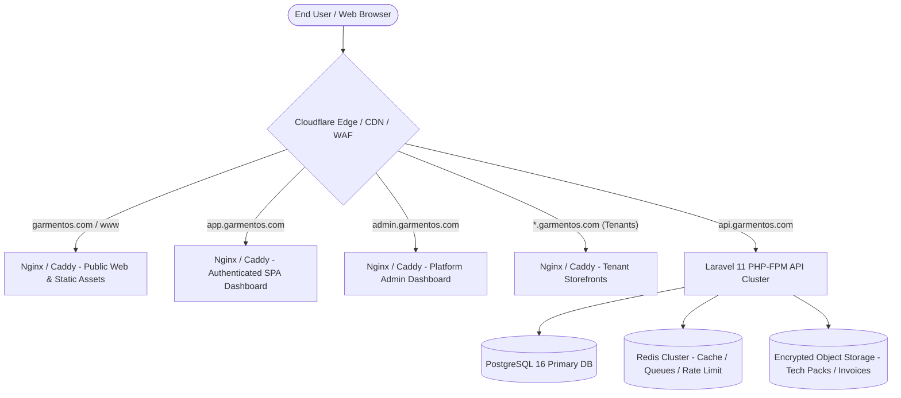

# GarmentOS Cloud — Production Domain & Subdomain Architecture Specification
## Target Release: November 15 Commercial Release | P1 Directive

---

## 1. Production Architecture Overview

GarmentOS Cloud operates as an industrial multi-tenant SaaS platform serving garment manufacturers, subcontractors, and their retail/wholesale customers across Egypt and the MENA region.

The production infrastructure separates traffic across dedicated hostnames to maximize security, isolation, cacheability, and user experience:



### Domain Routing Matrix:

| Domain / Subdomain | Target Audience | Technology | Primary Function | Auth Required |
| :--- | :--- | :--- | :--- | :--- |
| **`garmentos.com`** | Public, Prospects, Leads | React SPA / Static CDN | Official Marketing Website, Features, Pricing, ROI, Legal | No |
| **`www.garmentos.com`** | Public, Web Crawlers | Redirect 301 | Canonical 301 Redirect to `https://garmentos.com/` | No |
| **`app.garmentos.com`** | Factory Staff, Owners | React SPA (Auth Context) | Core Factory ERP (Cutting, BOM, CMT, Inventory, HR, Costing) | Yes |
| **`admin.garmentos.com`**| GarmentOS Operators | React SPA (Platform Context) | Platform Governance, Plan Subscriptions, Metrics, Global Audit | Yes (`platform_admin`) |
| **`api.garmentos.com`** | Frontend Apps & Integrations | Laravel 11 REST API | Microservices, Sanctum Auth, Business Logic, Payment Webhooks | Token / API Key |
| **`{slug}.garmentos.com`**| Factory Retail/B2B Shoppers | Public Storefront SPA | Factory Public Storefront, Catalog, Cart, Order Submission | No |
| **`garmentos.com/track`** | Garment End Customers | Public Order Tracker | Real-time production milestone tracking by order number & phone | No |

---

## 2. DNS Record Specifications

Assuming root domain `garmentos.com` managed via Cloudflare or Route53:

| Type | Name / Host | Target / Value | TTL | Proxy Status | Description |
| :--- | :--- | :--- | :--- | :--- | :--- |
| **A** | `@` (`garmentos.com`) | `198.51.100.10` (or ALIAS/CNAME to PaaS) | Auto | Proxied (Orange Cloud) | Apex Domain (Public Marketing) |
| **CNAME** | `www` | `garmentos.com` | Auto | Proxied | Redirect to Apex Domain |
| **CNAME** | `app` | `edge.garmentos.com` (or PaaS endpoint) | Auto | Proxied | Dedicated Application Subdomain |
| **CNAME** | `admin` | `edge.garmentos.com` | Auto | Proxied | Platform Admin Subdomain |
| **CNAME** | `api` | `api-cluster.garmentos.com` (or Railway) | Auto | Proxied | REST API Gateway |
| **CNAME** | `*` (Wildcard) | `edge.garmentos.com` | Auto | Proxied | Dynamic Tenant Storefront Subdomains |

> [!IMPORTANT]
> Cloudflare proxying (Orange Cloud) provides automated DDoS mitigation, HTTP/3, TLS 1.3 termination, and automated Brotli/Gzip compression.

---

## 3. SSL/TLS Certificate Specifications

To accommodate dynamic multi-tenancy (`{tenant}.garmentos.com`), the SSL/TLS certificate architecture must support wildcards:

1. **Certificate 1 (Primary & Subdomains):**
   - **Subject Alternative Names (SANs):**
     - `garmentos.com`
     - `*.garmentos.com`
   - **Provider:** Let's Encrypt / Cloudflare Universal SSL / AWS Certificate Manager (ACM)
   - **Validation Method:** DNS-01 Challenge (automated via Cloudflare API)
   - **Minimum TLS Version:** TLS 1.2, strictly preferring TLS 1.3
   - **Cipher Suites:** Modern ECDSA (P-256) + RSA 4096-bit fallback

2. **HSTS Header (HTTP Strict Transport Security):**
   ```http
   Strict-Transport-Security: max-age=31536000; includeSubDomains; preload
   ```

---

## 4. Reverse Proxy & Web Server Configurations

### 4.1 Production Nginx Configuration (`/etc/nginx/sites-available/garmentos.conf`)

```nginx
# 1. Canonical Redirect: www.garmentos.com -> garmentos.com
server {
    listen 80;
    listen 443 ssl http2;
    server_name www.garmentos.com;
    ssl_certificate /etc/letsencrypt/live/garmentos.com/fullchain.pem;
    ssl_certificate_key /etc/letsencrypt/live/garmentos.com/privkey.pem;
    return 301 https://garmentos.com$request_uri;
}

# 2. Public Marketing Website: garmentos.com
server {
    listen 443 ssl http2;
    server_name garmentos.com;

    ssl_certificate /etc/letsencrypt/live/garmentos.com/fullchain.pem;
    ssl_certificate_key /etc/letsencrypt/live/garmentos.com/privkey.pem;

    root /var/www/garmentos/apps/web/dist;
    index index.html;

    # Security Headers
    add_header X-Frame-Options "SAMEORIGIN" always;
    add_header X-Content-Type-Options "nosniff" always;
    add_header Referrer-Policy "strict-origin-when-cross-origin" always;
    add_header Content-Security-Policy "default-src 'self' https: data: blob: 'unsafe-inline' 'unsafe-eval';" always;

    location / {
        try_files $uri $uri/ /index.html;
    }

    # Static Assets Caching
    location ~* \.(js|css|png|jpg|jpeg|gif|ico|svg|woff|woff2|ttf|eot)$ {
        expires 1y;
        add_header Cache-Control "public, no-transform, immutable";
    }

    # API Proxy Fallback (same-origin routing)
    location /api/ {
        proxy_pass http://127.0.0.1:8000;
        proxy_set_header Host api.garmentos.com;
        proxy_set_header X-Real-IP $remote_addr;
        proxy_set_header X-Forwarded-For $proxy_add_x_forwarded_for;
        proxy_set_header X-Forwarded-Proto $scheme;
    }
}

# 3. Application & Subdomains: app.garmentos.com, admin.garmentos.com, *.garmentos.com
server {
    listen 443 ssl http2;
    server_name app.garmentos.com admin.garmentos.com *.garmentos.com;

    ssl_certificate /etc/letsencrypt/live/garmentos.com/fullchain.pem;
    ssl_certificate_key /etc/letsencrypt/live/garmentos.com/privkey.pem;

    root /var/www/garmentos/apps/web/dist;
    index index.html;

    location / {
        try_files $uri $uri/ /index.html;
    }

    location ~* \.(js|css|png|jpg|jpeg|gif|ico|svg|woff|woff2|ttf|eot)$ {
        expires 1y;
        add_header Cache-Control "public, no-transform, immutable";
    }

    location /api/ {
        proxy_pass http://127.0.0.1:8000;
        proxy_set_header Host $host;
        proxy_set_header X-Real-IP $remote_addr;
        proxy_set_header X-Forwarded-For $proxy_add_x_forwarded_for;
        proxy_set_header X-Forwarded-Proto $scheme;
    }
}

# 4. Dedicated Backend API Gateway: api.garmentos.com
server {
    listen 443 ssl http2;
    server_name api.garmentos.com;

    ssl_certificate /etc/letsencrypt/live/garmentos.com/fullchain.pem;
    ssl_certificate_key /etc/letsencrypt/live/garmentos.com/privkey.pem;

    root /var/www/garmentos/apps/api/public;
    index index.php;

    client_max_body_size 50M;

    location / {
        try_files $uri $uri/ /index.php?$query_string;
    }

    location ~ \.php$ {
        include fastcgi_params;
        fastcgi_pass unix:/run/php/php8.2-fpm.sock;
        fastcgi_param SCRIPT_FILENAME $realpath_root$fastcgi_script_name;
        fastcgi_param DOCUMENT_ROOT $realpath_root;
        fastcgi_buffer_size 128k;
        fastcgi_buffers 4 256k;
        fastcgi_busy_buffers_size 256k;
    }
}
```

---

## 5. Backend Laravel Configuration (CORS, Sanctum, Cookies)

### 5.1 Environment Configuration (`apps/api/.env`)
```env
APP_NAME="GarmentOS Cloud"
APP_ENV=production
APP_DEBUG=false
APP_URL=https://api.garmentos.com

# CORS Configuration - Explicit whitelist (no wildcard credentials)
CORS_ALLOWED_ORIGINS="https://garmentos.com,https://www.garmentos.com,https://app.garmentos.com,https://admin.garmentos.com"

# Sanctum Stateful Domains (matches top-level and first-party subdomains)
SANCTUM_STATEFUL_DOMAINS="garmentos.com,app.garmentos.com,admin.garmentos.com"

# Cross-Subdomain Session Sharing
SESSION_DRIVER=database
SESSION_DOMAIN=.garmentos.com
SESSION_SECURE_COOKIE=true
SESSION_SAME_SITE=lax
```

### 5.2 Dynamic Tenant Origin Validation
In `config/cors.php`, dynamic tenant subdomains matching `*.garmentos.com` are permitted using `allowed_origins_patterns`:
```php
'allowed_origins_patterns' => [
    '#^https://[a-z0-9-]+\.garmentos\.com$#',
],
```

---

## 6. Railway & Containerized Deployment Specification

When deploying via Railway or Docker:

### Frontend Service (`garmentos-web`):
- **Base image:** Node 20 Alpine -> Caddy / Nginx Alpine multi-stage build.
- **Port:** `80` (or `$PORT`).
- **Domain Mappings in Railway Dashboard:**
  - `garmentos.com`
  - `app.garmentos.com`
  - `admin.garmentos.com`
  - `*.garmentos.com`

### Backend Service (`garmentos-api`):
- **Base image:** PHP 8.2 FPM + Nginx.
- **Port:** `8000` (or `$PORT`).
- **Domain Mapping in Railway Dashboard:**
  - `api.garmentos.com`

---

## 7. Fallback Routing & Backward Compatibility

To guarantee 100% reliability for users who cannot access subdomains (e.g. strict corporate proxies blocking wildcard subdomains), the frontend architecture implements **Bi-Modal Path Fallbacks**:

1. **Tenant Storefronts:**
   - Primary: `https://{tenantSlug}.garmentos.com/`
   - Fallback: `https://garmentos.com/#/store/{tenantSlug}`
2. **Dedicated App Entry:**
   - Primary: `https://app.garmentos.com/`
   - Fallback: `https://garmentos.com/#/app`
3. **Public Order Tracker:**
   - Primary: `https://garmentos.com/track`
   - Fallback: `https://garmentos.com/#/store/track`

Both URLs parse into the exact same application state inside `parseCurrentRoute()`.

---

## 8. Rollback & Disaster Recovery Plan

In the event of a domain outage, DNS misconfiguration, or SSL certificate renewal block:

1. **Immediate DNS Rollback (RTO < 5 minutes):**
   - Cloudflare Page Rules allow instant failover redirect:
     `app.garmentos.com/*` -> `garmentos.com/#/app` (Temporary 302).
2. **SSL Fallback:**
   - Cloudflare Universal SSL automatically provides backup Edge certificates even if origin Let's Encrypt renewal encounters rate-limits.
3. **Database & API Isolation:**
   - API endpoints are versioned (`/api/v1`). Any DNS switch does not disrupt active Sanctum Bearer tokens stored in client sessions.

