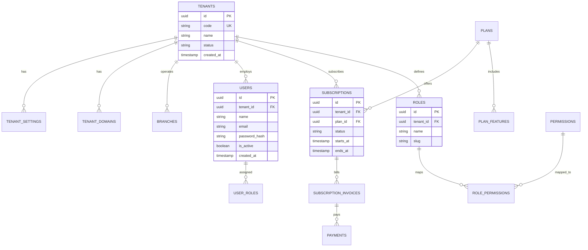
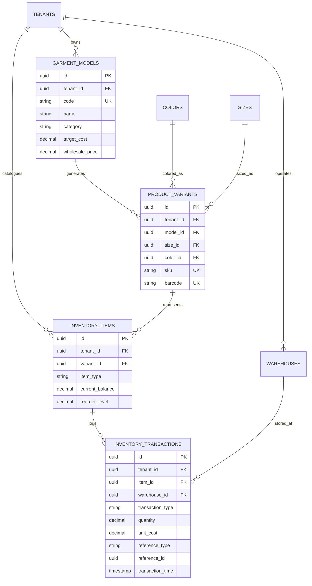
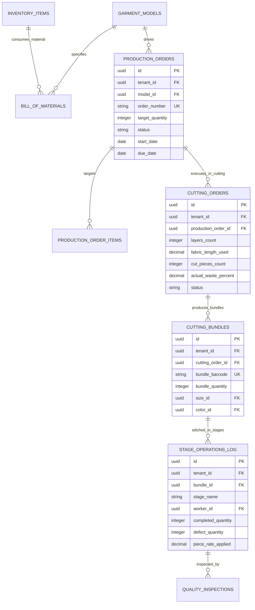
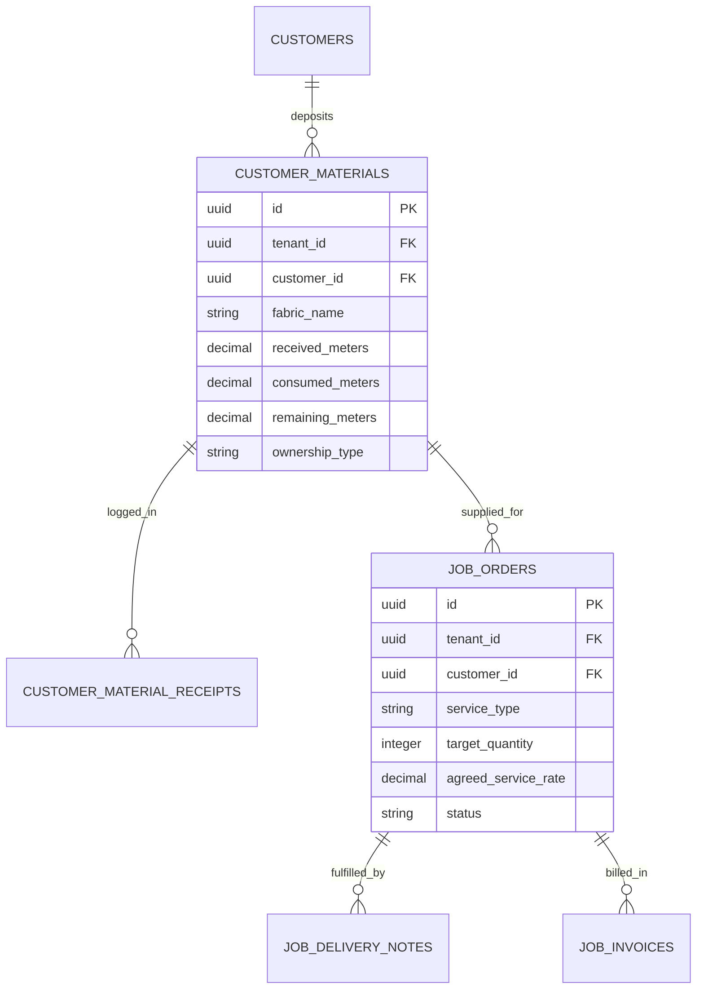
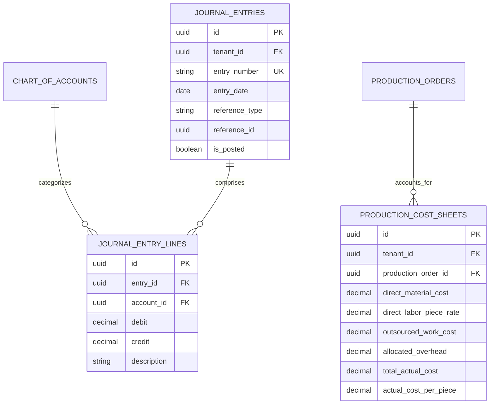

# GarmentOS Cloud — مخطط الكيانات والعلاقات (Entity Relationship Diagram - ERD)

## 1. مقدمة معمارية
يوثق هذا المخطط هيكلية العلاقات بين الجداول لقاعدة بيانات **GarmentOS Cloud** مع مراعاة العزل المتعدد للشركات (Multi-Tenancy) وقيود التكامل المرجعي (Foreign Keys).

---

## 2. مخطط العلاقات الرئيسي لـ Multi-Tenancy والصلاحيات

---

## 3. مخطط علاقات الموديلات والمخازن ودفتر الأستاذ (Catalog & Inventory)

---

## 4. مخطط علاقات تشغيل الإنتاج وقسم القص والجودة (Production, Cutting & QC)

---

## 5. مخطط أمانات خامات العملاء والقص للغير (Customer Materials & CMT)

---

## 6. مخطط التكلفة الفعلية والقيود المحاسبية (Actual Costing & General Ledger)

