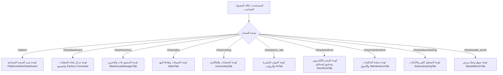

# تقرير تدقيق وفحص لوحات التحكم والواجهات التشغيلية (Batch 8 Dashboard UX/UI Audit)
## GarmentOS Cloud — Comprehensive Operational Dashboards Audit

**تاريخ التدقيق:** 4 نوفمبر 2026  
**المستودع:** `keroulsg/clothes` (`C:\Users\HP\Downloads\clothes`)  
**الفرع:** `main`  
**الهدف:** رصد مواطن الضعف البصري والتشغيلي في لوحات التحكم قبل تنفيذ التحسينات وإعادة التصميم.

---

## 1. الفحص المعماري لخرائط لوحات التحكم الحالية (Architecture Mapping)

على عكس التطبيقات البسيطة، يعتمد GarmentOS Cloud على معمارية أحادية الصفحة (Single Page Application - SPA) موجهة بحسب الصلاحيات والنطاقات الفرعية، حيث تتوزع لوحات التحكم والعمليات على الوحدات التالية:

---

## 2. نتائج الفحص ورصد المشكلات الفنية والبصرية (Audit Findings)

### 2.1 شريط التنقل العلوي والقائمة الجانبية (`AppLayout.tsx`):
- **الملاحظة:**
  - القائمة الجانبية مجمعة بشكل جيد، لكن لا يوجد تلميح مرئي واضح لحالة المصنع النشط أو المتجر الإلكتروني المباشر في الترويسة الرئيسية.
  - مربع البحث في شريط التنقل العلوي هو مجرد حقل شكلي غير مرتبط بوظيفة البحث السريع أو تصفية الأوامر.
  - قائمة المستخدم السريعة والتحويل بين اللغات تحتاج إلى تحسين التباين البصري وحدود القوائم المنبثقة لمنع التداخل في الوضعين الفاتح والداكن.
- **الحل المقترح:**
  - إضافة شارة / زر وصول سريع بارز لـ "موقع ومتجر المصنع" في شريط التنقل العلوي بجانب اسم التنت.
  - إضافة فلترة سريعة وتلميحات واضحة للمستخدم.
  - ضبط تباين ترويسة التطبيق والقوائم المنسدلة وفق توكنات Brand Burgundy.

### 2.2 لوحة قيادة المصنع والعمليات الصناعية (`activeTab === 'dashboard'` في `App.tsx`):
- **الملاحظة:**
  - بطاقات مؤشرات الأداء الحالية (KPIs) تعرض أرقاماً حقيقية من الخادم، لكن تفتقر إلى مؤشرات التقدم البصرية (Visual Progress Bars) ونسب الإنجاز.
  - جدول أوامر الإنتاج الجارية يعرض البيانات الحقيقية من `productionOrders`، لكن ينقصه حقل بحث بالاسم/الكود، وفلاتر حسب المرحلة (`الكل`، `صالة القص`، `الخياطة`، `فحص الجودة`)، وترقيم صفحات عند كثرة الأوامر.
  - غياب المخططات البيانية السريعة؛ لوحة التحكم خالية من أي رسوم توضيحية خفيفة تعرض توزيع مراحل التشغيل وتوزيع خامات الأقمشة في المخازن.
- **الحل المقترح:**
  - ترقية بطاقات الـ KPIs بإضافة أشرطة نسب الإنجاز ومقارنات الأهداف.
  - إضافة رسمين بيانيين خفيفين بنظام SVG الخالص دون أي مكتبات خارجية ثقيلة:
    1. مخطط توزيع مراحل الإنتاج (القص، الخياطة، الجودة، المكتمل).
    2. مخطط توزيع أرصدة الأقمشة حسب النوع والتصنيف.
  - دعم البحث المباشر، الفلاتر المرحلية، وترقيم الصفحات في جدول أوامر الإنتاج.

### 2.3 لوحة مدير المنصة السحابية (`PlatformAdminDashboard.tsx`):
- **الملاحظة:**
  - تعتمد اللوحة على مكونات CoreUI، مما يخلق تبايناً طفيفاً مع مكونات النظام المبنية بـ Tailwind.
  - جداول المستأجرين وسجلات التدقيق تحتاج إلى تحسين تباين النصوص وتنسيق حقول البحث.
- **الحل المقترح:**
  - تحسين مظهر البطاقات والجداول لتنسجم مع تصميم الـ ERP في كلا الوضعين الفاتح والداكن.

### 2.4 لوحات المستودعات، المبيعات، المحاسبة، والموارد البشرية:
- **الملاحظة:**
  - تم ربط هذه اللوحات بنجاح في الدفعات السابقة (Batch 0–6) مع الخادم الخلفي الحقيقي، وتوفر فلاتر وبحث وترقيم.
  - تحتاج إلى مراجعة تباين الخطوط والجداول في الوضعين الفاتح والداكن لضمان معايير WCAG AA، وضمان عدم حدوث تشويه اتجاهي (LTR/RTL Mirroring).

---

## 3. خطة التنفيذ المعتمدة للدفعة 8 (Batch 8 Implementation Plan)

1. **الخطوة 1:** تحسين وتطوير ترويسة وقائمة `AppLayout.tsx` مع إضافة زر الوصول المباشر للمتجر، وتحسين القوائم المنسدلة.
2. **الخطوة 2:** إعادة تصميم وتطوير لوحة تحكم المصنع الرئيسية في `App.tsx`:
   - بطاقات KPI حديثة مع نسب الإنجاز.
   - مخططات SVG بصرية حقيقية محسوبة من بيانات الأوامر والمخزون.
   - بحث وفلاتر مرحلية وترقيم لجدول أوامر التشغيل.
   - خلاصة تفاعلية لأحدث الأنشطة والتنبيهات المخزنية.
3. **الخطوة 3:** تحسين تباين وأنماط `PlatformAdminDashboard.tsx`.
4. **الخطوة 4:** التحقق الآلي:
   - تشغيل الـ Backend Regression Suite (424 اختباراً).
   - تشغيل الـ Frontend Typecheck & Build.
5. **الخطوة 5:** التحقق البصري الميداني والتقاط لقطات الشاشة الحقيقية عبر Chrome Headless في الأوضاع الأربعة:
   - عربي فاتح (Arabic RTL Light)
   - عربي داكن (Arabic RTL Dark)
   - إنجليزي فاتح (English LTR Light)
   - إنجليزي داكن (English LTR Dark)
6. **الخطوة 6:** إعداد تقرير الإنجاز النهائي وتحديث وثائق المشروع.

