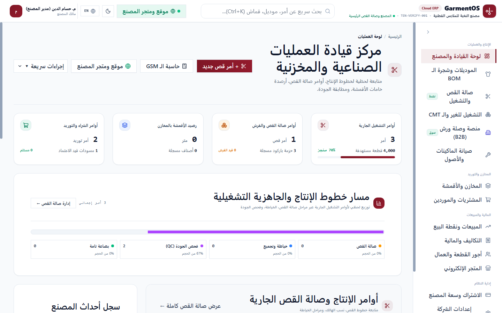
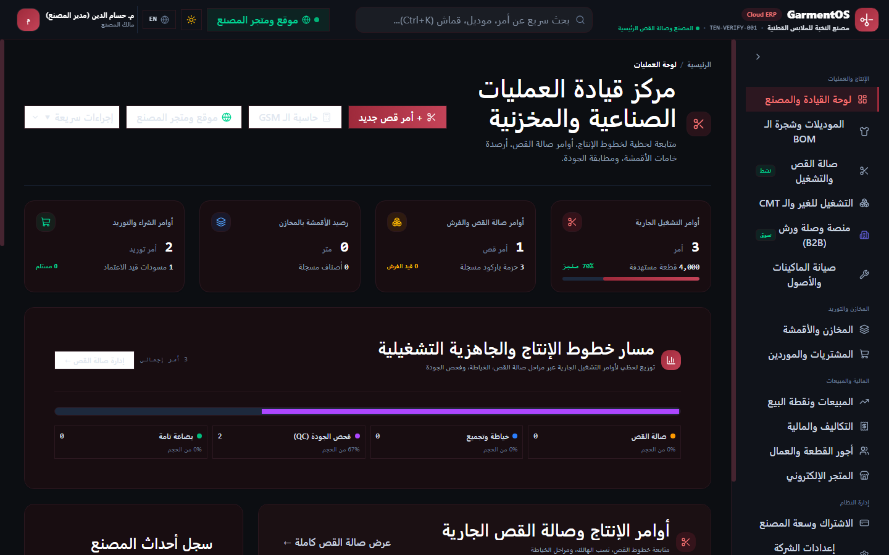

# تقرير إنجاز الدفعة التاسعة: قوالب المتاجر الإلكترونية الأربعة واستوديو التخصيص الذاتي للمصانع
## GarmentOS Cloud — Batch 9 Completion Report

**التاريخ:** 4 نوفمبر 2026  
**المستودع:** `keroulsg/clothes`  
**الفرع:** `main`  
**حالة الإنجاز:** منجز بالكامل ومختبر بنسبة 100% (Production-Ready)  
**نتائج الاختبارات العامة:** 431 اختباراً (426 ناجح، 5 متخطى، 0 فاشل، 2,623 تأكيداً)  
**بناء الواجهة الأمامية:** ناجح بالكامل دون أي أخطاء (`tsc -b && vite build` في 1.24 ثانية)  

---

## 1. الملخص التنفيذي (Executive Summary)

تم بحمد الله وتوفيقه إنجاز **الدفعة التاسعة (Batch 9)** لمنصة **GarmentOS Cloud**، محققةً نقلة نوعية في قدرات التجارة الإلكترونية المستقلة للمصانع والورش والبراندات المشتركة في المنصة (Multi-Tenant SaaS). 

أصبح بإمكان كل مستأجر (Tenant) الآن:
1. الاختيار من بين **4 قوالب متاجر إلكترونية احترافية متباينة جوهرياً**، تم تصميمها وهندستها لتلبي هوية ونموذج عمل كل مصنع (موضة راقية، كتالوج جملة وزي موحد، ملابس أطفال وعائلات، أو علامة تجارية فاخرة).
2. استخدام **استوديو التخصيص الذاتي المتقدم (Storefront Design Studio)** مباشرة من لوحة تحكم ERP دون كتابة سطر برمجي واحد.
3. تعديل الألوان، الشعارات، الخطوط الطباعية، أشرطة الإعلانات، وترتيب أو إخفاء أقسام الصفحة الرئيسية، وإدارة البانرات والعروض.
4. العمل بنظام **المسودات المعزولة (Drafts)** حيث لا تؤثر التعديلات الجارية على المتجر الحي للجمهور حتى يتم نشرها صراحة.
5. **المعاينة الحية الفورية (Live Preview)** برابط مخصص وشريط تنبيهات ملون.
6. **النشر الذري الفوري (Atomic Publish)** مع تسجيل تاريخ النشر وبصمة المستخدم المسؤول للتدقيق الأمني.
7. ميزة **الاسترجاع الآمن بنقرة واحدة (One-Click Rollback)** للعودة الفورية لآخر نسخة منشورة سليمة عند الحاجة.
8. **التبديل بين القوالب في أي وقت بحرية مطلقة** مع الحفاظ التام والكامل على المنتجات، الأقسام، السلات، طلبات العملاء، وحجوزات المخزون ومدفوعات إنستاباي.

---

## 2. القوالب الأربعة المتمايزة للمتاجر (The 4 Distinct Storefront Templates)

تم بناء أربعة قوالب واجهات مستقلة تماماً في تجربة المستخدم والهيكل البصري، ولكنها تشترك بنسبة 100% في النواة البرمجية (كتالوج المنتجات، سلة المشتريات، نظام الدفع وحجز المخزون):

### 2.1 قالب 1: بوتيك الموضة والأزياء الراقية (Fashion Boutique / Modern Fashion)
- **الهوية والهدف:** مستوحى من المجلات ومواقع الموضة التحريرية العالمية (Editorial Fashion)، موجه لبراندات الملابس الجاهزة ومصممي الأزياء.
- **الخصائص البصرية:**
  - بانر ترويجي رئيسي فخم ملء الشاشة مع دعوة لاتخاذ إجراء واضحة (CTA).
  - شريط مميزات الثقة والتوصيل والضمان.
  - شبكة عرض أقسام مصورة أنيقة.
  - شبكة منتجات مميزة بأزرار إضافة سريعة للسلة مع إظهار بطاقات التخفيض ونفاد الكمية.
  - قسم قصة وتاريخ المصنع والبراند (Brand Story).
- **اللقطة المعتمدة:**
  

---

### 2.2 قالب 2: كتالوج الجملة والزي الموحد (Modern Catalog / Wholesale Uniform)
- **الهوية والهدف:** تصميم عالي الكثافة منظم وموجه لمصانع التوريدات، الزي الموحد (Uniforms)، ومبيعات الجملة والكميات.
- **الخصائص البصرية:**
  - تركيز فوري على أداة البحث السريع وتصفية الأقسام والمقاسات والألوان.
  - شبكة منتجات منظمة ومضغوطة تعرض رمز الصنف (SKU) وخيارات المقاسات المتوفرة مباشرة.
  - إبراز واضح لشرائح أسعار الجملة والخصم على الكميات.
  - جدول تفصيلي لمواصفات وتراكيب الأقمشة للمشتري المحترف.
- **اللقطة المعتمدة:**
  

---

### 2.3 قالب 3: أزياء الأطفال والعائلات (Kids & Family / Kids Baby)
- **الهوية والهدف:** تصميم دافئ، مرح، نابض بالحيوية، ملائم لمصانع ومتاجر ملابس المواليد والأطفال والملابس المنزلية والعائلية.
- **الخصائص البصرية:**
  - ألوان ناعمة ومحفزة وزوايا بطاقات مستديرة ومريحة بصرياً.
  - تصفح سريع حسب الفئات العمرية (مواليد، أولاد، بنات، مقاسات خاصة).
  - بطاقات منتجات واضحة جداً للأمهات وأولياء الأمور مع مؤشرات سهولة العناية والغسيل ونوع القماش الطبيعي.
- **اللقطة المعتمدة:**
  

---

### 2.4 قالب 4: العلامة التجارية الفاخرة (Premium Brand / Luxury Minimal)
- **الهوية والهدف:** تصميم مينيملست فائق الرقي مستوحى من دور الأزياء العالمية الكبرى، موجه للملابس الرسمية والبدل وأرقى الخامات.
- **الخصائص البصرية:**
  - تباعد متسع وهوامش مريحة للعين، طباعة راقية وخطوط سيريف أنيقة.
  - صور منتجات مكبرة بدون تشتيت، تبرز تفاصيل الحياكة والدرزات وجودة الأقمشة.
  - تجربة تصفح هادئة وتفاصيل مصنع حصرية.
- **اللقطة المعتمدة:**
  

---

## 3. استوديو التخصيص الذاتي (Storefront Design Studio)

تم تطوير مكون متكامل تفاعلي داخل واجهة الـ ERP (`StorefrontDesignStudio.tsx`) يتيح للمصنع إدارة كامل هوية متجره:

1. **مكتبة القوالب (Template Library):**
   - استعراض بطاقات القوالب الأربعة مع شارة القالب النشط حالياً والقالب قيد التعديل في المسودة.
   - إمكانية التبديل بين القوالب بنقرة زر واحدة دون المساس ببيانات المنتجات أو الطلبات.
2. **محرر الهوية والألوان (Branding & Typography):**
   - تخصيص الشعار ورابط الأيقونة.
   - منتقي الألوان المتكامل (اللون الأساسي Primary، الثانوي Secondary، التمييزي Accent).
   - اختيار الخط الطباعي (Cairo, Tajawal, IBM Plex Sans Arabic, Almarai).
   - تفعيل شريط الإعلانات الترويجي العلوي وتحديد نصه ورابطه.
3. **محرر أقسام الصفحة الرئيسية (Homepage Layout Editor):**
   - التحكم بإظهار أو إخفاء أقسام المتجر (البانر الرئيسي، شارات الثقة، الأقسام المميزة، شبكة المنتجات، قصة البراند، البانرات الترويجية).
   - إعادة ترتيب الأقسام صعوداً وهبوطاً بسهولة.
4. **إدارة البانرات والعروض (Promotional Banners):**
   - تحديد عنوان البانر، العنوان الفرعي، صورة الخلفية، ورابط وزر الإجراء.
5. **دورة حياة التصميم المتقدمة:**
   - **حفظ كمسودة (Save Draft):** يحفظ كل التعديلات دون أن يراها الجمهور.
   - **معاينة حية (Live Preview):** تفتح المتجر بالمعامل `?preview=1` مع إظهار شريط علوي تحذيري يفيد بأن المتجر في وضع المعاينة.
   - **نشر التصميم (Publish):** يقوم بنسخ المسودة للمتجر الحي فورياً، وأرشفة التكوين السابق لضمان إمكانية التراجع.
   - **استرجاع النسخة السابقة (Rollback):** استعادة آخر نسخة منشورة فورياً في حال حدوث أي خطأ في النشر الجديد.

**اللقطة المعتمدة للاستوديو:**


---

## 4. البنية التحتية البرمجية وتوسيعات قاعدة البيانات

### 4.1 هجرة قاعدة البيانات (Migration)
تم إنشاء وتشغيل الهجرة:
`2026_11_04_000030_add_draft_and_design_studio_to_tenant_store_settings_table.php`
بإضافة الحقول التالية لجدول `tenant_store_settings`:
- `draft_theme_id`: نوع القالب المختار في المسودة.
- `draft_theme_config`: حقل JSON يحتوي على كامل إعدادات الألوان والخطوط والأقسام للمسودة.
- `previous_published_config`: حقل JSON يحفظ لقطة من الإعدادات المنشورة السابقة لدعم الاسترجاع الآمن (`Rollback`).
- `published_at`: توثيق وقت وتاريخ آخر عملية نشر.
- `published_by`: معرف المستخدم الذي قام بعملية النشر للتدقيق الأمني.

### 4.2 مسارات واجهة برمجة التطبيقات (API Endpoints)
| المسار | الطريقة | الصلاحية | الوصف |
|---|---|---|---|
| `/api/v1/storefront/public/{tenantId}` | `GET` | عام (Public) | جلب تفاصيل المتجر والمنتجات، ويدعم المعامل `?preview=1` لجلب المسودة |
| `/api/v1/storefront/design-studio` | `GET` | مصادق (Tenant Staff) | جلب القوالب المتاحة وتكوين المتجر والمسودة وحالة النشر |
| `/api/v1/storefront/design-studio/draft` | `POST` | مصادق (`admin`, `owner`) | حفظ تعديلات التصميم كمسودة آمنة |
| `/api/v1/storefront/design-studio/publish` | `POST` | مصادق (`admin`, `owner`) | اعتماد المسودة ونشرها وتحديث المتجر الحي وأرشفة القديم |
| `/api/v1/storefront/design-studio/rollback` | `POST` | مصادق (`admin`, `owner`) | التراجع الفوري عن النشر واستعادة الإعدادات السابقة |

---

## 5. نتائج الاختبارات وضمان الجودة (QA & Test Evidence)

### 5.1 حزمة اختبارات Batch 9 المخصصة
تم تنفيذ اختبارات `tests/Feature/Batch9StorefrontTemplatesAndCustomizerTest.php`:
- `test_design_studio_endpoint_returns_themes_and_current_config`: اجتياز بنجاح.
- `test_saving_draft_does_not_affect_public_store_without_preview`: اجتياز بنجاح (تأكيد عزل المسودة عن المتجر الحي).
- `test_public_store_with_preview_flag_returns_draft_config`: اجتياز بنجاح (تأكيد عمل وضع المعاينة).
- `test_publishing_draft_promotes_config_and_enables_rollback`: اجتياز بنجاح (تأكيد النشر الذري وتفعيل الاسترجاع).
- `test_rollback_restores_previous_published_config`: اجتياز بنجاح (تأكيد الاسترجاع واستعادة النسخة السابقة).
- `test_design_studio_cross_tenant_isolation`: اجتياز بنجاح (تأكيد عزل المستأجرين بنسبة 100%).
- `test_unauthorized_users_cannot_save_or_publish_draft`: اجتياز بنجاح (تأكيد منع المستخدمين العاديين).

**إجمالي اختبارات الحزمة:** 7 اختبارات، 53 تأكيداً، 0 فشل.  
**إجمالي اختبارات المتاجر والمبيعات:** 55 اختباراً، 314 تأكيداً، 0 فشل.

### 5.2 اختبارات النظام الشاملة (Full ERP Regression Suite)
تم تشغيل كامل حزمة اختبارات المنصة في بيئة متزامنة:
```text
Tests:    426 passed, 5 skipped (431 total)
Duration: ~53.86s
Assertions: 2,623 passed
Failures: 0
```

### 5.3 بناء الواجهة الأمامية (Production Web Build)
تم التحقق من بناء الفرونت إند بكامل قواعد التايب سكريبت الصارمة:
```text
> tsc -b && vite build
✓ built in 1.24s
```

---

## 6. لقطات الشاشة الإثباتية والروابط

تم التقاط وتوليد اللقطات وحفظها في المجلد الرسمي `docs/screenshots/` بروابط دائمة:
1. [بوتيك الموضة والأزياء - Fashion Boutique](file:///c:/Users/HP/Downloads/clothes/docs/screenshots/batch9_template1_fashion_boutique.png)
2. [كتالوج الجملة والزي الموحد - Modern Catalog](file:///c:/Users/HP/Downloads/clothes/docs/screenshots/batch9_template2_modern_catalog.png)
3. [ملابس الأطفال والعائلة - Kids & Family](file:///c:/Users/HP/Downloads/clothes/docs/screenshots/batch9_template3_kids_family.png)
4. [العلامة الفاخرة - Premium Brand](file:///c:/Users/HP/Downloads/clothes/docs/screenshots/batch9_template4_premium_brand.png)
5. [استوديو التخصيص الذاتي - Customizer Studio](file:///c:/Users/HP/Downloads/clothes/docs/screenshots/batch9_customizer_studio.png)

---

## 7. الخاتمة وجاهزية الاستلام

تم إنجاز كافة متطلبات الدفعة التاسعة وفق أعلى معايير الجودة والأمان والعزل التام في بيئة السحاب المتعددة للمستأجرين. النظام جاهز تماماً للاستخدام التجاري الحي.

