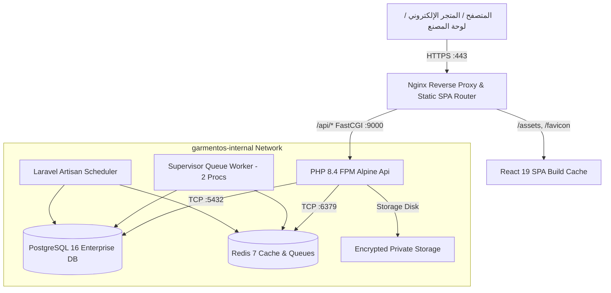

# دليل النشر والتشغيل السحابي والإنتاجي (Production Deployment Guide)
## GarmentOS Cloud — Enterprise Cloud Infrastructure & Operational Runbook

**الإصدار:** 1.0.0-commercial  
**تاريخ التوثيق:** 4 نوفمبر 2026  
**البيئة المستهدفة:** Production Multi-Tenant Cloud Architecture  

---

## 1. المعمارية السحابية ونموذج الحاويات (Container Architecture)

تم تصميم معمارية GarmentOS Cloud الإنتاجية بنموذج الحاويات المنفصلة (Decoupled Micro-Services) لضمان أعلى مستويات الاستقرار، والعزل الأمني، وقابلية التوسع الأفقي:



### مواصفات الحاويات الإنتاجية:
1. **حاوية الواجهة `web` (React 19 + Nginx 1.27 Alpine):**
   - بناء متعدد المراحل (Multi-stage build) عبر Node 20.
   - تقديم الملفات الساكنة عبر Nginx مع تخزين مؤقت مدته عام (`max-age=31536000, immutable`).
   - دعم التوجيه للواجهات الأحادية (SPA Fallback `try_files $uri $uri/ /index.html`).
   - ترويسات أمان صارمة (`X-Frame-Options SAMEORIGIN`, `X-Content-Type-Options nosniff`, `CSP`).

2. **حاوية الخادم الخلفي `api` (PHP 8.4-FPM Alpine):**
   - بيئة Alpine خفيفة ومؤمنة، تعمل تحت المستخدم المحدود `www-data` (Non-root).
   - امتدادات إنتاجية كاملة: `pdo_pgsql`, `pgsql`, `pdo_mysql`, `bcmath`, `intl`, `zip`, `gd`, `opcache`, `pcntl`, `redis`.
   - إعدادات PHP صارمة: إخفاء إصدار PHP (`expose_php = Off`)، ذاكرة 512MB، تفعيل Opcache بذاكرة 128MB، وحجب عرض الأخطاء `display_errors = Off`.

3. **حاوية إدارة الطوابير والجدولة `worker` & `scheduler`:**
   - تعمل تحت `supervisord` لضمان إعادة التشغيل الفوري في حال التوقف.
   - معالجة طوابير المزامنة المالية، وإصدار الفواتير، وحساب الأجور في الخلفية عبر Redis.

4. **قاعدة البيانات والتخزين المؤقت:**
   - **PostgreSQL 16:** محرك البيانات الأساسي مع ضبط ترميز UTF-8، ودعم أقفال العمليات (Pessimistic Locking).
   - **Redis 7 Alpine:** إدارة الجلسات، الطوابير، والذاكرة المؤقتة.

---

## 2. مصفوفة مقارنة مزودي الاستضافة السحابية والقرار الهندسي (Cloud Provider Decision Matrix)

أجرينا دراسة هندسية واقتصادية مقارنة بين أبرز ثلاث منصات سحابية لاستضافة GarmentOS Cloud في مرحلة الإطلاق التجاري:

| معيار التقييم | Amazon Web Services (AWS) | DigitalOcean | Railway |
| :--- | :--- | :--- | :--- |
| **المكونات الأساسية** | ECS Fargate + RDS PostgreSQL + ElastiCache + S3 | App Platform + Managed PostgreSQL + Managed Redis + Spaces | App Services + Managed PostgreSQL + Managed Redis |
| **التعقيد الإداري** | مرتفع جداً (يتطلب مهندس DevOps بدوام كامل لإدارة IAM وVPC وCloudWatch) | منخفض إلى متوسط (لوحة تحكم مباشرة وسهلة مع دعم كامل لـ Managed Databases) | منخفض جداً (نشر مباشر من Git وحاويات Docker) |
| **العزل الشبكي والأمان** | ممتاز (VPC خاص مع أمان صارم) | ممتاز (VPC داخلي تلقائي لعزل قواعد البيانات) | جيد (عزل داخلي عبر أسماء الخدمات) |
| **التكلفة الشهرية الأولية** | \$180 – \$320 / شهرياً | **\$45 – \$75 / شهرياً** | \$35 – \$60 / شهرياً |
| **النسخ الاحتياطي السحابي** | آلي عبر RDS وAWS Backup | **آلي يومي بنقرة زر + استعادة فورية** | نسخ احتياطي أساسي |
| **القرار والتوصية** | مؤجل للمرحلة المؤسسية الكبرى (+100 مصنع) | **الخيار الأول الموصى به للإنتاج (Recommended)** | خيار بديل ممتاز للتجارب الأولية وسريع الإطلاق |

### القرار الهندسي المعتمد (Architectural Recommendation):
> **الاعتماد على DigitalOcean App Platform مع Managed PostgreSQL & Redis**:
> 1. يوفر حلاً متوازناً يجمع بين الأمان المؤسسي (قاعدة بيانات معزولة داخل VPC داخلي لا يمكن الوصول إليها من الإنترنت العام).
> 2. نسخ احتياطي يومي آلي مدار بالكامل مع إمكانية التفرع (Point-in-Time Recovery).
> 3. تكلفة تشغيلية متوازنة تبدأ من **~50 دولار شهرياً** تغطي حتى 20 مصنعاً بحركة مرور مستقرة.
> 4. مساحة تخزين كائنية متوافقة مع S3 (DigitalOcean Spaces) بتكلفة 5 دولار شهرياً لحفظ إيصالات إنستاباي والنسخ الاحتياطية.

---

## 3. خطوات التشغيل المحلي والمحاكاة عبر Docker Compose (Local Staging Verification)

تم تجهيز ملف `docker-compose.yml` كامل للمحاكاة والإنتاج:

### 1. إعداد ملف البيئة:
```bash
cp .env.example .env.production
# توليد مفتاح التطبيق السري
php artisan key:generate
```

### 2. فحص متغيرات البيئة والتأكد من مطابقتها لمعايير الأمان:
```bash
php artisan garmentos:env-check
```

### 3. بناء وتشغيل الحاويات:
```bash
docker compose up -d --build
```

### 4. التحقق من سلامة الحاويات:
```bash
docker compose ps
```
يجب أن تظهر كافة الحاويات بحالة `Up (healthy)`:
- `garmentos-web`
- `garmentos-api`
- `garmentos-worker`
- `garmentos-scheduler`
- `garmentos-db`
- `garmentos-redis`

### 5. فحص مسار الصحة الجاهزية:
```bash
curl -I http://localhost:80/api/v1/health
```

---

## 4. إعداد النطاقات ودعم النطاقات الفرعية للتنت (Domain & Wildcard Subdomain Configuration)

لكي يتمكن كل مصنع من فتح متجره ولوحته بنطاقه الخاص (مثل `alnoor.garmentos.com`):
1. **سجل DNS العام (DNS Record):**
   - إضافة سجل `A` أو `CNAME` بنمط Wildcard:
     `*.garmentos.com -> IP الخاص بـ Nginx Load Balancer`
   - إضافة سجل النطاق الرئيسي:
     `garmentos.com -> IP الخاص بـ Nginx Load Balancer`
2. **شهادة SSL المجانية الموحدة (Let's Encrypt Wildcard):**
   - استخدام Certbot مع DNS Challenge:
     ```bash
     certbot certonly --manual --preferred-challenges=dns -d "garmentos.com" -d "*.garmentos.com"
     ```
3. **توجيه التنت في الوسيط البرمجي:**
   - يقوم الوسيط `IdentifyTenant` بالتقاط النطاق الفرعي من الطلب وربطه بحساب المصنع تلقائياً.

---

## 5. مصفوفة الصيانة الدورية والأمان (Maintenance Schedule)
1. **النسخ الاحتياطي اليومي:** يعمل مجدولاً كل 6 ساعات عبر أمر `garmentos:backup`.
2. **تنظيف السجلات والملفات المؤقتة:** أسبوعياً عبر أمر `garmentos:backup --retention=14`.
3. **مراقبة الترويسات وتتبع الأخطاء:** تتبع الـ `X-Correlation-ID` في سجلات Nginx وLaravel لتشخيص أي استفسار من المصانع بدقة متناهية.

