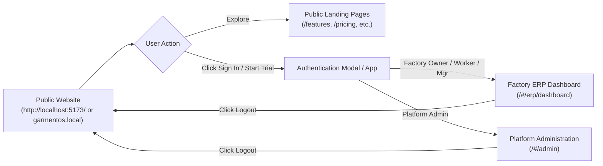

# GarmentOS Cloud — Local Domain & Routing Architecture Guide

## 1. Executive Summary & Routing Philosophy

GarmentOS Cloud adopts a **Public-First, Role-Aware, Context-Isolated Multi-Tenant Routing Architecture**.

The customer experience journey enforces the following strict order:


### Core Rules:
1. **Opening the root URL (`/` or `/#/`) ALWAYS renders the official GarmentOS marketing website**, regardless of whether an active auth token exists in client storage.
2. If a user is already authenticated when visiting the public marketing website, a prominent **"لوحة التحكم / Dashboard"** button is displayed in the navigation header, allowing immediate entry into their active workspace.
3. Unauthenticated requests to protected ERP (`/#/erp/*`) or Admin (`/#/admin/*`) routes are intercepted and immediately redirected to the public website with the authentication modal open (`openLogin: true`).
4. Logging out revokes the backend Sanctum token, purges stored credentials from `localStorage`, and cleanly redirects the browser to `/#/`.
5. Public tenant storefronts (`/#/store/{tenantSlug}`) and customer order tracking (`/#/store/track`) are accessible publicly without requiring authentication.

---

## 2. Local Hostnames & Port Specifications

| Tier / Role | Local URL (Zero-Config Default) | Local Domain (Custom Hosts) | Production Target | Access Control |
| :--- | :--- | :--- | :--- | :--- |
| **Public Website** | `http://localhost:5173/` | `http://garmentos.local:5173/` | `https://garmentos.com/` | Public |
| **Dedicated App / Login** | `http://localhost:5173/#/app` or `#/login` | `http://app.garmentos.local:5173/` | `https://app.garmentos.com/` | Public -> Auth |
| **Factory ERP Dashboard** | `http://localhost:5173/#/erp/dashboard` | `http://app.garmentos.local:5173/#/erp` | `https://app.garmentos.com/#/erp` | Authenticated Factory Roles |
| **Platform Admin** | `http://localhost:5173/#/admin` | `http://admin.garmentos.local:5173/` | `https://admin.garmentos.com/` | Authenticated `platform_admin` |
| **Tenant Storefront** | `http://localhost:5173/#/store/alnoor-kids` | `http://alnoorkids.garmentos.local:5173/` | `https://alnoorkids.garmentos.com/` | Public Storefront |
| **Order Tracking** | `http://localhost:5173/#/store/track` | `http://garmentos.local:5173/#/store/track` | `https://garmentos.com/track` | Public Tracking |
| **Backend API Gateway** | `http://127.0.0.1:8000/api/v1` | `http://api.garmentos.local:8000/api/v1` | `https://api.garmentos.com/v1` | Token / Tenant Scoped |

---

## 3. Option A: Zero-Config Localhost Mode (Recommended for Development)

Standard browsers (Chrome, Edge, Firefox, Safari) support RFC 6761 where `localhost` and `*.localhost` (e.g. `app.localhost:5173`, `tenant.localhost:5173`) automatically resolve to `127.0.0.1` without modifying the operating system's hosts file.

### Quick Start:
1. **Start Backend API:**
   ```bash
   cd apps/api
   php artisan serve --host=127.0.0.1 --port=8000
   ```
2. **Start Frontend Dev Server:**
   ```bash
   cd apps/web
   npm run dev -- --host=127.0.0.1 --port=5173
   ```
3. **Open Browser:**
   - Public Website: `http://localhost:5173/`
   - Dedicated App Entry: `http://localhost:5173/#/app`
   - Storefront Example: `http://localhost:5173/#/store/alnoor-kids`
   - Order Tracker: `http://localhost:5173/#/store/track`

---

## 4. Option B: Custom Domain Simulation (`garmentos.local`)

To test authentic multi-subdomain isolation matching production DNS:

### 1. Update OS Hosts File
Run your text editor with Administrator / Superuser privileges:

- **Windows:** `C:\Windows\System32\drivers\etc\hosts`
- **macOS / Linux:** `/etc/hosts`

Add the following mappings:
```text
127.0.0.1   garmentos.local
127.0.0.1   www.garmentos.local
127.0.0.1   app.garmentos.local
127.0.0.1   admin.garmentos.local
127.0.0.1   api.garmentos.local
127.0.0.1   alnoorkids.garmentos.local
```

### 2. Configure Backend `.env`
In `apps/api/.env`:
```env
APP_URL=http://localhost:8000
CORS_ALLOWED_ORIGINS="http://localhost:5173,http://localhost:3000,http://127.0.0.1:5173,http://garmentos.local:5173,http://app.garmentos.local:5173,http://admin.garmentos.local:5173,http://alnoorkids.garmentos.local:5173"
SANCTUM_STATEFUL_DOMAINS="localhost,localhost:5173,127.0.0.1,127.0.0.1:8000,garmentos.local:5173,app.garmentos.local:5173,admin.garmentos.local:5173"
SESSION_DOMAIN=null
```

### 3. Frontend `.env`
In `apps/web/.env`:
```env
VITE_API_BASE_URL=/api/v1
VITE_API_URL=http://localhost:8000/api/v1
VITE_PUBLIC_URL=http://garmentos.local:5173
VITE_APP_URL=http://app.garmentos.local:5173
```

---

## 5. End-to-End Verification Procedure

| Step | Action | Expected Result |
| :--- | :--- | :--- |
| **1. Root Access** | Open `http://localhost:5173/` | Official GarmentOS marketing homepage renders with Hero, Modules overview, ROI calculator, and Pricing. Does NOT jump into ERP. |
| **2. Unauthenticated ERP Access** | Navigate to `http://localhost:5173/#/erp/dashboard` | Route parser detects unauthenticated state; renders public homepage with LoginModal open. |
| **3. Factory Owner Login** | Enter credentials `qa_nile.owner` / `Secret123!` | Login modal closes; browser transitions to `/#/erp/dashboard`; Factory ERP loads with Nile Garment Factory context. |
| **4. Refresh Persistence** | Refresh `http://localhost:5173/#/erp/dashboard` | ERP session preserved; dashboard renders smoothly without re-prompting. |
| **5. Return to Website** | Open `http://localhost:5173/#/` | Public website renders; navigation header displays active **"لوحة التحكم / Dashboard"** button. |
| **6. Dashboard Shortcut** | Click **"لوحة التحكم / Dashboard"** button | Immediately routes back to `/#/erp/dashboard`. |
| **7. Logout Flow** | Click User Avatar -> "تسجيل الخروج / Logout" | Token revoked on backend, client storage wiped, redirected to `/#/` public homepage. |
| **8. Platform Admin Login** | Click "دخول المصنع" -> Enter platform admin credentials | Authenticates and immediately redirects to `/#/admin` (Central Platform Administration). |
| **9. Public Storefront** | Navigate to `http://localhost:5173/#/store/alnoor-kids` | Tenant public storefront renders catalog, products, and cart without authentication. |
| **10. Order Tracking** | Navigate to `http://localhost:5173/#/store/track` | Customer order tracking interface renders with order number and phone search fields. |

---

## 6. Troubleshooting Local Routing Issues

### Issue 1: CORS Errors when Calling Backend API
- **Symptom:** `Access-Control-Allow-Origin` missing in console.
- **Root Cause:** Direct calls from browser origin not matched in `CORS_ALLOWED_ORIGINS`.
- **Solution:** Use the built-in Vite reverse proxy (`VITE_API_BASE_URL=/api/v1`). All calls route through `http://localhost:5173/api/v1` and are transparently forwarded to `http://127.0.0.1:8000`.

### Issue 2: Old Token Keeps Opening Dashboard
- **Symptom:** Opening `/` bypasses marketing site.
- **Root Cause:** Legacy route parser checked `isAuthenticated()` on root path.
- **Solution:** Fixed in `App.tsx`! Root path (`/` or `/#/`) unconditionally returns `mode: 'public', publicPage: 'home'`.

