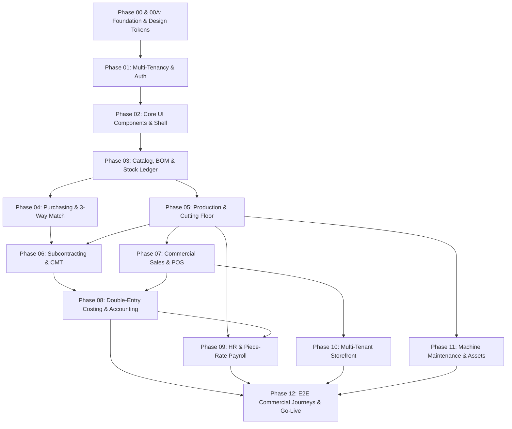

# GARMENTOS CLOUD — MASTER IMPLEMENTATION ROADMAP (PHASE 02B)

**Date:** October 22, 2026  
**Status:** **AUTHORITATIVE PLANNING BASELINE**  
**Architecture:** Monorepo (Laravel 11 Backend + React 19 / TypeScript / Vite Frontend)  
**Target Release:** Production Commercial Release v1.0.0

---

## 1. Executive Program Sequence & Dependency Graph

---

## 2. Phase-by-Phase Completion & Target Schedule

| Phase | Title | Verified Status | Remaining Technical Tasks | Target Milestone |
| :--- | :--- | :--- | :--- | :--- |
| **Phase 00-06**| Core Foundations, Catalog, Purchasing, Cutting & Subcontracting | **VERIFIED COMPLETE** | Master data, BOM, 3-way match, bundle QR & CMT custody. | Baseline Complete |
| **Phase 07B**| Commercial Sales & Return Automation | **VERIFIED COMPLETE** | Sales return modal, credit note posting & 80mm thermal receipt verified. | Complete (`2de5c57`) |
| **Phase 08B**| Advanced Accounting & Industrial Costing | **VERIFIED COMPLETE** | Trial balance, income statement, balance sheet, VAT summary & cost variance. | Complete (`5b76e5d`) |
| **Phase 09B**| Workforce & Piece-Rate HR Rules | **VERIFIED COMPLETE** | QC defect deductions, worker objections, overhead configuration & payroll integrity. | Complete (`4383316`) |
| **Phase 10** | Storefront Multi-Theme Engine & InstaPay Audit | **VERIFIED COMPLETE** | 4 theme families, tenant branding, manual InstaPay audit & stock sync. | Complete (`c0f404b`, `03ad16f`) |
| **Phase A**  | **Current-System Acceptance & Missing Journeys** | **IN PROGRESS (Current Sprint)** | Repair POS/sales flows, standalone customer store routes, public order tracking, receipt submission & PostgreSQL CI concurrency. | Sprint Gate |
| **Phase B**  | **Raw-Material & Finished-Goods Warehouses** | **PLANNED (Phase +1)** | Multi-warehouse zones/bins, reserved/on-hand stock, transfers, cycle counts & movement ledger. | Sprint Gate |
| **Phase C**  | **Product Catalog, POS, Invoices & Returns** | **PLANNED (Phase +2)** | Barcode search, POS quantity validation, authorized discounts, returns/credit notes & thermal layout. | Sprint Gate |
| **Phase D**  | **Workforce, Attendance, Overtime & Payroll** | **PLANNED (Phase +3)** | Piece-rate, hourly & agreed rate methods, spreadsheet attendance grid, biometric import & payroll locking. | Sprint Gate |
| **Phase E**  | **Financial Vouchers, Cheques, Receivables & Installments** | **PLANNED (Phase +4)** | Receipt/payment vouchers, statements, cheque registers, installment agreements & idempotent posting. | Sprint Gate |
| **Phase E2** | **Complete UI/UX Design System** | **PLANNED (Phase +5)** | Consistent typography, spacing, RTL/LTR, dark/light contrast & standardized printable documents. | Sprint Gate |
| **Phase F**  | **Fully Functional Public Storefront** | **PLANNED (Phase +6)** | Full e-commerce pages across 4 themes (Home, Categories, Cart, Checkout, Policies) with tenant branding. | Sprint Gate |
| **Phase G**  | **Waslat Worsh Marketplace** | **PLANNED (Phase +7)** | Workshop profiles, RFQ bidding, quote-to-job-order conversion reusing `SubcontractingService`. | Sprint Gate |
| **Phase H**  | **Final Operational Readiness** | **PLANNED (Phase +8)** | E2E integration test suite, PostgreSQL CI validation, backup/restore & production release documentation. | Production Gate |

---

## 3. Active Phase: Phase A — Current-System Acceptance & Missing Journeys

* **Dependency:** Phase 07B (Sales), Phase 08B (Accounting), Phase 10 (Storefront Themes).
* **Objective:**
  1. Inspect and repair POS, sales invoices, and drawer balances end-to-end.
  2. Implement standalone public customer storefront routes (`#/store/:tenantSlug`), real product browsing, checkout, order creation, InstaPay receipt submission, and customer order tracking (`#/store/track`).
  3. Verify seamless integration among products, stock, sales, payments, and customer accounts.
  4. Document and configure PostgreSQL CI requirements for the 5 skipped concurrency tests.
* **Core Entities:** `StoreOrder`, `SalesInvoice`, `InventoryItem`, `InventoryTransaction`, `PosSession`.
* **Deliverable:** Working standalone public customer storefront journey, customer order lookup, InstaPay receipt upload, and automated test coverage.
