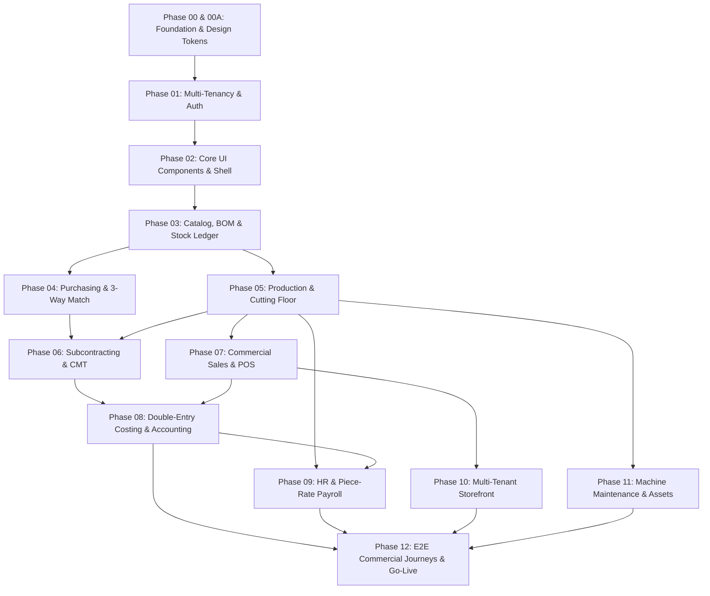

# GARMENTOS CLOUD — MASTER IMPLEMENTATION ROADMAP (PHASE 02B)

**Date:** October 22, 2026  
**Status:** **AUTHORITATIVE PLANNING BASELINE**  
**Architecture:** Monorepo (Laravel 11 Backend + React 19 / TypeScript / Vite Frontend)  
**Target Release:** Production Commercial Release v1.0.0

---

## 1. Executive Program Sequence & Dependency Graph

---

## 2. Phase-by-Phase Completion & Target Schedule

| Phase | Title | Verified Status | Remaining Technical Tasks | Target Milestone |
| :--- | :--- | :--- | :--- | :--- |
| **Phase 00** | Monorepo & Database Foundation | **VERIFIED COMPLETE** | Zero schema drift, strict health probes. | Complete |
| **Phase 00A** | Visual System & WCAG Recovery | **VERIFIED COMPLETE** | Royal Burgundy palette & high-contrast slate. | Complete |
| **Phase 01** | Multi-Tenancy & RBAC Engine | **VERIFIED COMPLETE** | Fail-closed TenantScope active. | Complete |
| **Phase 02** | Design System & Reusable Components | **VERIFIED COMPLETE** | ActionsMenu, Modals, Pagination active. | Complete |
| **Phase 03** | Styles, Sizes/Colors & Stock Ledger | **VERIFIED COMPLETE** | Variant barcode matrix and BOM details connected. | Complete |
| **Phase 04** | Purchasing, Suppliers & 3-Way Match | **VERIFIED COMPLETE** | GRN inspection, invoice tolerance verification. | Complete |
| **Phase 05** | Cutting Floor, Lay Planning & Bundles | **VERIFIED COMPLETE** | QR bundle transfers and AQL inspections. | Complete |
| **Phase 06** | Subcontracting & CMT Custody | **VERIFIED COMPLETE** | Outside operations and customer material isolation. | Complete |
| **Phase 07B**| Commercial Sales & Return Automation | **VERIFIED COMPLETE** | Sales return modal, credit note posting & 80mm thermal receipt verified. | Complete |
| **Phase 08B**| Advanced Accounting & Financial Reports | **IN QUEUE (Phase +2)** | Trial balance CSV export & VAT return summary. | Sprint 2 |
| **Phase 09B**| HR Biometric Integration & Overtime | **IN QUEUE (Phase +3)** | Biometric attendance sync & penalty calculation. | Sprint 3 |
| **Phase 10** | Storefront & COD Orders | **VERIFIED COMPLETE** | Authoritative pricing & domain verification active. | Complete |
| **Phase 11** | Machine Registry & Maintenance | **VERIFIED COMPLETE** | MTBF/MTTR metrics & work order spare parts. | Complete |
| **Phase 12** | Commercial Go-Live & Security Gate | **VERIFIED COMPLETE** | 8 end-to-end integration journeys passing. | Production Gate |

---

## 3. The Next Three Implementation Phases (Ordered by Dependencies)

### Phase 1: Commercial Sales & Returns Completion (Phase 07B)
* **Dependency:** Phase 03 (Inventory Ledger) + Phase 05 (Finished Goods Stock).
* **Objective:** Close remaining commercial gaps by implementing a dedicated **Sales Return & Credit Note Modal** from the invoice row, and a **Thermal POS Receipt Print Preview** for outlet cashiers.
* **Core Entities:** `SalesOrder`, `SalesInvoice`, `SalesReturn`, `CreditNote`, `InventoryTransaction`.
* **Deliverable:** Full return lifecycle returning goods to warehouse with ledger credit note.

### Phase 2: Industrial Costing & Financial Reporting (Phase 08B)
* **Dependency:** Phase 07B (Sales Revenue) + Phase 04 (Purchasing Costs) + Phase 09 (Labor Costs).
* **Objective:** Provide automated **Trial Balance, Income Statement & Balance Sheet Exports** (Excel/CSV) and an **Audited Manufacturing Cost Variance Sheet** comparing standard BOM cost vs. actual cutting/sewing costs.
* **Core Entities:** `Account`, `JournalEntry`, `JournalEntryLine`, `ProductionCostSheet`.
* **Deliverable:** Live financial statements accessible to authorized Financial Accountants and Factory Owners.

### Phase 3: Advanced Workforce & Piece-Rate Rules (Phase 09B)
* **Dependency:** Phase 05 (Bundle Operations) + Phase 08B (Payroll Expenses).
* **Objective:** Expand the HR tab to handle **Overtime Multipliers, Production Defect Deductions**, and **Worker Attendance Webhooks** (biometric machine integration).
* **Core Entities:** `Employee`, `PieceRate`, `DailyWorkLog`, `PayrollRun`, `AttendanceRecord`.
* **Deliverable:** Automated monthly payroll run including piece work + hourly overtime - QC penalty deductions.

---

## 4. Immediate First Implementation Task

* **Task ID:** `TASK-07B-01`
* **Title:** Implement Sales Return & Credit Note Modal in `SalesTab.tsx`
* **Route:** `#/erp/sales`
* **Components:** `apps/web/src/components/sales/SalesReturnModal.tsx`, `apps/web/src/api/client.ts`, `apps/api/app/Http/Controllers/Api/SalesController.php`
* **Acceptance Criteria:**
  1. User can click "إرجاع مبيعات" from any paid or delivered sales order/invoice.
  2. Input returned quantities with reason (defect, customer exchange, size mismatch).
  3. API creates negative stock movement in `inventory_transactions` returning units to designated warehouse.
  4. Generates offsetting credit note entry in accounting ledger.
  5. Tested with automated regression test in `tests/Feature/SalesReturnTest.php`.
