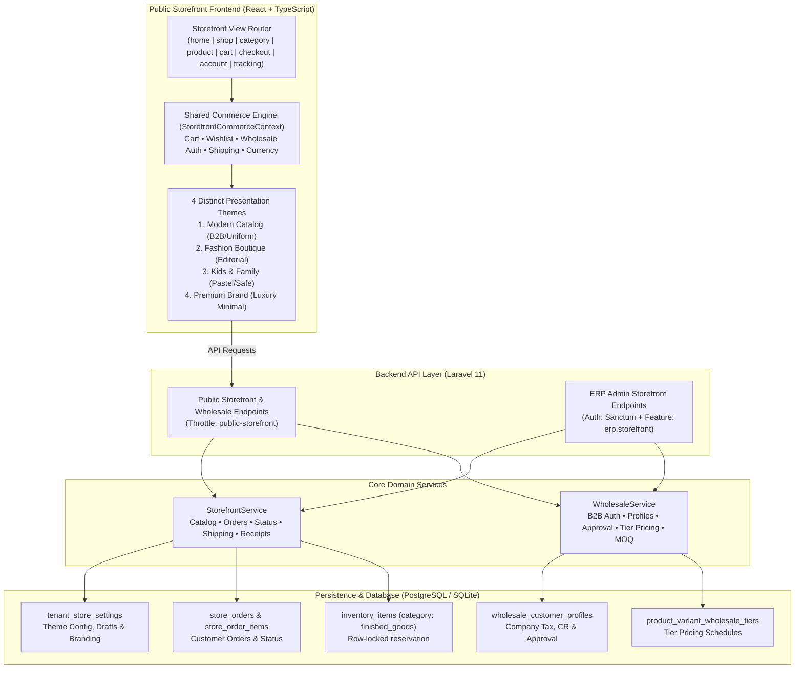

# GarmentOS Cloud — Storefront Architecture & Domain Design

**Repository:** `keroulsg/clothes`  
**Branch:** `garmentos/storefront-bom-development`  
**Document Version:** 1.0.0  
**Status:** Approved for Implementation  

---

## 1. Architectural Philosophy & Layered Structure

The GarmentOS Cloud Storefront is engineered as a decoupled, multi-tenant e-commerce system seamlessly integrated into the factory ERP. It adheres to three core tenets:
1. **Separation of Concerns:** The Shared Commerce Engine owns all state, business rules, cart calculations, stock validation, and API interactions. The Theme Presentation Layer is purely presentational and renders according to theme-specific brand styles and layouts.
2. **Server-Authoritative Consistency:** Prices, wholesale volume discounts, minimum order quantities (MOQ), shipping costs, and inventory allocations are strictly evaluated and locked on the backend. The client cannot forge prices or reserve unbacked stock.
3. **Strict Factory Stock Isolation:** The storefront only reads and reserves Finished Goods (`category = 'finished_goods'`). It never touches raw fabrics, yarns, or production accessories directly during checkout.

---

## 2. Shared Commerce Engine Architecture

The Shared Commerce Engine provides a unified interface (`StorefrontCommerceContext`) consumed across all four themes and all page-level views:

### 2.1 State & Actions Specification

- **Navigation State:**
  - `activeView`: `'home' | 'shop' | 'category' | 'product' | 'cart' | 'checkout' | 'account' | 'tracking'`
  - `selectedProductId`: Product variant ID currently open in PDP.
  - `selectedCategoryId`: Category currently active in catalog/category view.
  - `searchTerm`: Query string for live search.
  - `filters`: Faceted filters `{ priceRange: [min, max], sizes: string[], colors: string[], inStockOnly: boolean, sortBy: string }`.
- **Shopping Cart State:**
  - `items`: `CartItem[]` (variant ID, name, size, color, quantity, unit price, available stock, MOQ, wholesale tiers).
  - `addItem(variant, quantity)`: Enforces finished goods stock limit and wholesale MOQ.
  - `updateQuantity(variantId, quantity)`: Dynamically re-evaluates wholesale tier pricing based on quantity.
  - `removeItem(variantId)`: Removes line item.
  - `clearCart()`: Empties cart.
  - `subtotal`: Sum of all items evaluated at current tier prices.
  - `shippingEstimate`: Authoritative calculation based on selected city/governorate.
  - `total`: `subtotal + shippingEstimate - discount`.
- **Wholesale & Customer State:**
  - `wholesaleUser`: Profile data of approved B2B partner (or null for retail guests).
  - `isWholesaleAuthenticated`: Boolean.
  - `loginWholesale(email, password)`: Authenticates B2B user and retrieves encrypted session token.
  - `registerWholesale(formData)`: Submits new B2B trade application.
  - `logoutWholesale()`: Clears credentials and reverts catalog to retail prices.
- **Wishlist State:**
  - `wishlist`: `string[]` of variant IDs, persisted in `localStorage` and synchronized with customer account.
  - `toggleWishlist(variantId)`: Adds/removes item with feedback toast.

---

## 3. Dedicated View Architecture

Instead of popup modals, the platform implements dedicated full-page components:

1. **`StorefrontProductDetailPage` (PDP):**
   - Media Gallery: Main high-resolution image with hover zoom + clickable multi-angle thumbnails.
   - Variant Selector: Color swatch buttons + Size selector pills with live inventory indicator ("In Stock", "Only X Left", "Out of Stock").
   - Pricing & Wholesale Matrix: Retail price display + Wholesale Tier Breakdown Table showing volume discounts for approved B2B accounts.
   - Minimum Order Quantity (MOQ) indicator and quantity stepper with MOQ clamping.
   - Accordion for Fabric Composition, Care Instructions, Size & Fit Guide, and Shipping & Returns.
   - Customer Reviews with verified buyer star rating summary.
   - Related Products slider based on category or collection.

2. **`StorefrontShopPage` (Catalog):**
   - Faceted Filter Sidebar: Category checklist, Price slider, Size filter pills (S, M, L, XL, XXL, etc.), Color filter swatches, Stock status ("In Stock Only").
   - Toolbar: Item count, sort dropdown ("Featured", "Price: Low to High", "Price: High to Low", "Best Selling", "Newest Arrivals"), and layout toggle (Grid 3-column / 4-column / List).
   - Responsive Mobile Filter Drawer.

3. **`StorefrontCategoryPage`:**
   - Hero header with category title, description, and aesthetic background.
   - Child category quick-jump pills.
   - Breadcrumb navigation (`Home > Category > Subcategory`).
   - Filtered product grid.

4. **`StorefrontCartPage` & Quick Cart Drawer:**
   - Quick slide-out drawer for fast add-to-cart confirmation.
   - Dedicated `/cart` page with detailed line items, live inventory re-check warnings, quantity adjustments, coupon input field, and order summary card.

5. **`StorefrontCheckoutPage`:**
   - 4-Section Accordion/Step flow:
     - Section 1: Customer Contact & Account (Guest checkout or Wholesale Login).
     - Section 2: Delivery Address (Full name, Egyptian Governorate dropdown, City, Street address, Phone, WhatsApp).
     - Section 3: Delivery Options & Authoritative Shipping Calculation.
     - Section 4: Payment Method (Cash on Delivery [COD] vs InstaPay Instant Bank Transfer with QR code and receipt upload).
     - Section 5: Final Order Review & Submit with double-click protection lock.

6. **`StorefrontAccountPage`:**
   - Tabs: `Orders`, `Profile`, `Addresses`, `Wishlist`, `Wholesale Trade Status`.
   - Order history with live order status badges and quick "Track Package" action.

7. **`StorefrontOrderTrackingPage`:**
   - Public order lookup by Order Number + Phone number.
   - Visual progress timeline (`Order Placed` -> `Confirmed` -> `In Preparation` -> `Out for Delivery` -> `Delivered`).
   - InstaPay receipt status banner if awaiting accountant verification.

---

## 4. Server-Authoritative Inventory & Pricing Lifecycle

### 4.1 Finished Goods Inventory Reservation
When `StorefrontService::placeStoreOrder` is executed:
1. An atomic database transaction is initiated (`DB::beginTransaction()`).
2. Each requested item's corresponding `InventoryItem` (`category = 'finished_goods'`) is locked with `lockForUpdate()`.
3. The available stock is strictly computed as:
   $$\text{Available Stock} = \text{current\_balance} - \text{reserved\_balance}$$
4. If $\text{Available Stock} < \text{Requested Quantity}$, the transaction aborts with an `Insufficient stock` exception detailing the exact SKU and balance.
5. If valid, $\text{reserved\_balance} += \text{quantity}$ is committed immediately.
6. A `SalesOrder` and `SalesOrderItem` are created atomically in the factory ERP with `status = 'confirmed'` and `channel = 'storefront'`.

### 4.2 Wholesale Pricing Evaluation Hierarchy
$$\text{Effective Unit Price} = \begin{cases} 
\text{Tier Price}(Q) & \text{if Wholesale Authenticated and Tier matches } Q \ge \text{min\_quantity} \\
\text{Variant Standard Price} & \text{otherwise}
\end{cases}$$
The backend recalculates the unit price on line-item insertion based on the authenticated customer's token, ignoring any client-sent price overrides.

---

## 5. Security & Rate Limiting Architecture

- **Public Endpoint Throttling:** All public storefront routes are guarded by `throttle:public-storefront` (60 requests/minute per IP) to prevent catalog scraping and checkout denial-of-service.
- **Tenant Scoping:** Every query explicitly scopes by `tenant_id` resolved from subdomain or route parameter.
- **Admin Authorization:** Administrative endpoints require Sanctum bearer token and role-based permissions (`role:company_owner,sales_manager,accountant`).
- **Input Sanitization:** Strict request validation on orders, address fields, and telephone numbers to prevent injection attacks.
