# GarmentOS Cloud — Storefront Implementation Roadmap

**Repository:** `keroulsg/clothes`  
**Branch:** `garmentos/storefront-bom-development`  
**Execution Model:** Strict Sequential Phase Delivery (No Phase Skipping)  

---

## Roadmap Overview & Phases

```mermaid
flowchart LR
    P0["Phase 0<br/>Audit & Baseline"] --> P1["Phase 1<br/>Commerce Engine"]
    P1 --> P2["Phase 2<br/>Dedicated Pages"]
    P2 --> P3["Phase 3<br/>4 Distinct Themes"]
    P3 --> P4["Phase 4<br/>Shipping & Tax"]
    P4 --> P5["Phase 5<br/>B2B Wholesale"]
    P5 --> P6["Phase 6<br/>Builder Studio"]
    P6 --> P7["Phase 7<br/>Store Admin"]
    P7 --> P8["Phase 8<br/>Promotions & SEO"]
    P8 --> P9["Phase 9<br/>ERP & BOM Stock"]
    P9 --> P10["Phase 10<br/>Lifecycle States"]
    P10 --> P11["Phase 11<br/>Security & a11y"]
    P11 --> P12["Phase 12<br/>Automated Tests"]
    P12 --> P13["Phase 13<br/>Visual QA Matrix"]
    P13 --> P14["Phase 14<br/>Acceptance Reports"]
```

---

## Detailed Phase Breakdown & Verification Gates

### [x] Phase 0: Non-Destructive Audit & Baseline Reconciliation
- [x] Create `docs/STOREFRONT_CURRENT_STATE_AUDIT.md`.
- [x] Create `docs/STOREFRONT_FEATURE_GAP_MATRIX.md`.
- [x] Create `docs/STOREFRONT_ARCHITECTURE.md`.
- [x] Create `docs/STOREFRONT_IMPLEMENTATION_ROADMAP.md`.
- [ ] Commit Phase 0 documentation baseline: `audit(storefront): reconcile current branch and commerce baseline`.

### [ ] Phase 1: Separation of Shared Commerce Engine from Presentation Themes
- [ ] Implement `StorefrontCommerceContext.tsx` providing centralized state for:
  - Page navigation state (`activeView`, `selectedProduct`, `selectedCategory`, `searchQuery`, `filters`).
  - Cart management (`items`, `addItem`, `updateQuantity`, `removeItem`, `clearCart`, `subtotal`, `total`).
  - Customer / Wholesale auth (`wholesaleUser`, `token`, `login`, `register`, `logout`).
  - Customer wishlist (`wishlist`, `toggleWishlist`).
  - Currency formatting and language direction (`ar`/`en`, `RTL`/`LTR`).
- [ ] Create shared UI commerce building blocks:
  - Header & Top announcement bar with search, language toggle, theme toggle, wishlist counter, cart counter, and account link.
  - Footer with store policies, contact details, WhatsApp button, and copyright.
  - Cart Drawer with instant line item increment/decrement and checkout CTA.
  - Toast notification system for cart/wishlist feedback.

### [ ] Phase 2: Complete Dedicated Page-Level Storefront Views
- [ ] Implement `StorefrontProductDetailPage.tsx` (PDP):
  - Multi-image gallery with zoom lens and thumbnail selector.
  - Interactive color swatches and size buttons with live stock indicators.
  - Wholesale volume pricing table and MOQ badges.
  - Expandable accordion tabs (Details, Fabric & Care, Size Guide, Reviews).
  - Quantity selector with stock ceiling and MOQ floor.
  - Related products carousel.
- [ ] Implement `StorefrontShopPage.tsx` (Catalog):
  - Faceted filter sidebar (Categories, Price range, Sizes, Colors, Stock only).
  - Sort selector (Price asc/desc, Newest, Best selling).
  - Grid view / List view toggle.
- [ ] Implement `StorefrontCategoryPage.tsx`:
  - Category banner, breadcrumb hierarchy, child category chips, filtered grid.
- [ ] Implement `StorefrontCartPage.tsx`:
  - Full-page shopping cart with line items, SKU, variant chips, live stock alerts.
  - Coupon code submission field and discount calculation.
  - Estimated shipping calculator.
- [ ] Implement `StorefrontCheckoutPage.tsx`:
  - 4-step progressive disclosure:
    - Step 1: Customer Identification (Guest vs B2B account).
    - Step 2: Delivery Address (Governorate, City, Street, Phone, Notes).
    - Step 3: Authoritative Shipping Calculation & Zone review.
    - Step 4: Payment selection (COD vs InstaPay transfer with QR code).
  - Order review with terms acceptance and duplicate submission protection.
- [ ] Implement `StorefrontAccountPage.tsx`:
  - Profile details, order history with live status chips, saved addresses, and wishlist.
- [ ] Implement `StorefrontOrderTrackingPage.tsx`:
  - Lookup by Order Number and Phone number with visual delivery milestone stepper.

### [ ] Phase 3: Four Genuinely Distinct Premium Themes
- [ ] **Modern Catalog (`ModernCatalogTemplate.tsx`):**
  - High-density B2B wholesale layout, tabular variant matrix, quick-order buttons, bulk RFQ banner.
- [ ] **Fashion Boutique (`FashionBoutiqueTemplate.tsx`):**
  - High-fashion editorial aesthetic, wide hero photography, curated lookbook grid, floating cart button.
- [ ] **Kids & Family (`KidsFamilyTemplate.tsx`):**
  - Warm pastel color palette, age bracket pills (0-2y, 2-6y, 6-12y, Teens), organic/cotton safety badges.
- [ ] **Premium Brand (`PremiumBrandTemplate.tsx`):**
  - Minimalist luxury aesthetic, dark & champagne accents, bespoke craftsmanship highlights, VIP concierge CTA.

### [ ] Phase 4: Configurable Shipping Engine, Taxes & Coupons
- [ ] Extend `calculateAuthoritativeShipping` to support tenant-configured shipping rates in `theme_config['shipping']` (flat rate, custom city rates, free shipping threshold).
- [ ] Implement coupon validation endpoint and discount calculation logic.

### [ ] Phase 5: Production-Grade Wholesale (B2B) Integration
- [ ] Verify Wholesale registration, approval flow, and encrypted session storage.
- [ ] Enforce MOQ on both frontend steppers and backend transaction validation.
- [ ] Render volume tier pricing tables on PDP and cart with dynamic savings calculations.

### [ ] Phase 6: Storefront Builder & Theme Customization Studio
- [ ] Verify `StorefrontDesignStudio.tsx` live preview in Desktop, Tablet, and Mobile viewport modes.
- [ ] Enable customization of brand colors, hero banners, announcement bar, navigation links, and social URLs.
- [ ] Verify draft saving, atomic publishing, and one-click rollback.

### [ ] Phase 7: Store Administration, Orders & Payments
- [ ] Audit `StorefrontTab.tsx` in ERP dashboard.
- [ ] Verify order management: list, filter by status, search by order number or customer phone.
- [ ] Verify InstaPay receipt verification workflow (Approve -> double-entry payment voucher, Reject -> notify customer).
- [ ] Verify Wholesale customer trade application moderation.

### [ ] Phase 8: Promotions, Product Reviews, Wishlist & SEO Engine
- [ ] Wishlist persistence across sessions and customer account synchronization.
- [ ] Customer product reviews with verified purchase indicators.
- [ ] SEO metadata generation (OpenGraph tags, meta titles, descriptions).

### [ ] Phase 9: Factory ERP, Inventory Policy & BOM Lifecycle
- [ ] Verify strict finished goods stock isolation (`current_balance - reserved_balance >= quantity`).
- [ ] Confirm storefront sales never consume raw materials directly.
- [ ] Confirm order cancellation replenishes reserved finished goods inventory cleanly.

### [ ] Phase 10: Order Lifecycle State Machine
- [ ] Enforce state transitions: `pending` -> `confirmed` -> `processing` -> `shipped` -> `delivered`.
- [ ] Cancellation transitions with audit logging.

### [ ] Phase 11: Security, Rate Limiting & Accessibility
- [ ] Verify `throttle:public-storefront` protects all public endpoints.
- [ ] Ensure full keyboard navigation, screen-reader aria labels, and WCAG AA contrast compliance.
- [ ] Validate RTL / LTR layout switching and Arabic font rendering.

### [ ] Phase 12: Automated Testing & Verification
- [ ] Run full backend test suite (`php artisan test`).
- [ ] Run full frontend TypeScript compilation and build (`tsc -b && vite build`).
- [ ] Execute comprehensive e-commerce test cases covering retail and wholesale checkout flows.

### [ ] Phase 13: Real Browser Verification & Visual QA
- [ ] Spin up local development environment.
- [ ] Capture real browser screenshots across all 4 theme combinations (Modern Catalog, Fashion Boutique, Kids & Family, Premium Brand) in Arabic RTL and English LTR.
- [ ] Test mobile responsiveness.

### [ ] Phase 14: Final Reports & Delivery Closure
- [ ] Publish `docs/STOREFRONT_IMPLEMENTATION_REPORT.md`.
- [ ] Publish `docs/STOREFRONT_VISUAL_QA_REPORT.md`.
- [ ] Publish `docs/STOREFRONT_E2E_TEST_REPORT.md`.
- [ ] Verify repository cleanliness and provide final delivery summary.
