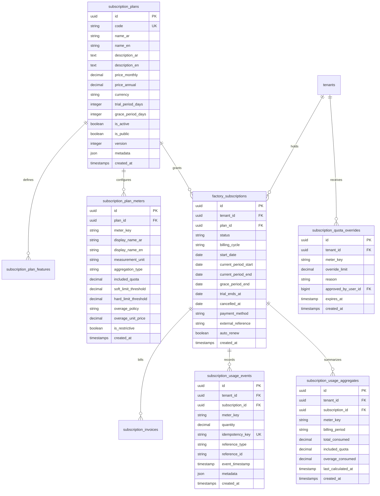

# GarmentOS Cloud — Subscription Plans, Entitlements & Usage Metering Architecture

**Date:** October 31, 2026  
**Document Status:** Approved Architecture & Implementation Blueprint  
**Authors:** Senior Software Architect & Lead Backend Engineer  
**Scope:** Configurable SaaS Subscription Tiers, Usage Meters, Idempotent Event Ledger, Quota Enforcement & Billing Lifecycle

---

## 1. Architectural Vision & Business Requirements

GarmentOS Cloud serves a diverse ecosystem ranging from small independent cutting workshops (1–2 tables) to large enterprise apparel manufacturers with multiple factories, hundreds of sewing operators, and multi-warehouse supply chains.

Subscriptions and factory usage metering are **first-class commercial domains** within the platform:
- Plans, quotas, and feature entitlements are completely **data-driven and configurable** by Platform Administrators. No commercial prices, tier names, or quota limits are hardcoded in application logic.
- A **double-entry immutable usage ledger** (`subscription_usage_events`) records all metered consumption with idempotency keys to prevent duplicate billing or race conditions.
- Quota enforcement operates **server-side** with a dual soft-limit (informational warnings at 70%, 85%, 100%) and hard-limit policy, accompanied by graceful overrides for in-flight operations (e.g., an in-progress cutting lay or active payroll run is never terminated midway).
- The architecture cleanly isolates tenant consumption: no cross-tenant usage aggregation or data leakage.

---

## 2. Entity-Relationship & Database Schema



---

## 3. Subscription Meter Dimensions & Catalog

| Meter Key | Display Name (AR / EN) | Unit | Aggregation Method | Billing Policy | Restrictive? |
|:---|:---|:---:|:---:|:---:|:---:|
| `active_users` | المستخدمون النشطون / Active Users | count | Gauge (Max Concurrent) | Permanent seat quota | Yes (blocks `POST /auth/register-user`) |
| `active_branches` | الفروع والمقرات / Branches | count | Gauge (Current Total) | Multi-location capacity | Yes (blocks `POST /branches`) |
| `active_warehouses`| المستودعات / Warehouses | count | Gauge (Current Total) | Storage partition quota | Yes (blocks `POST /warehouses`) |
| `active_employees` | سجلات العمال والموظفين / Employees | count | Gauge (Active Total) | Workforce capacity | Yes (blocks `POST /hr/employees`) |
| `garment_models` | الموديلات والأنماط / Garment Models | count | Gauge (Active Total) | Catalog style quota | Yes (blocks `POST /models`) |
| `production_orders`| أوامر الإنتاج الشهرية / Monthly Production Orders | orders | Period Cumulative Sum | Monthly volume allowance | Yes (warns at 85%, blocks new orders at 100%) |
| `cutting_lays` | فرشات وأوامر القص / Monthly Cutting Orders | lays | Period Cumulative Sum | Monthly cutting volume | Informational / Soft (never blocks lay in progress) |
| `purchase_orders` | أوامر الشراء والتوريد / Monthly Purchase Orders | orders | Period Cumulative Sum | Procurement volume | Yes (blocks `POST /purchase-orders`) |
| `sales_orders` | أوامر البيع والمبيعات / Monthly Sales Orders | orders | Period Cumulative Sum | Commercial transaction quota | Soft Limit (supports overage billing) |
| `subcontract_jobs`| عقود التشغيل للغير / Monthly CMT Subcontract Jobs | jobs | Period Cumulative Sum | Job order volume | Yes (blocks `POST /subcontracting/jobs`) |
| `storage_megabytes`| استهلاك التخزين / File & Document Storage | MB | Gauge (Current Bytes / 1MB)| Digital file capacity | Soft Limit (notifies factory admin) |
| `marketplace_bids` | طلبات وعروض وصلة ورش / Marketplace RFQs & Bids | count | Period Cumulative Sum | B2B trading allowance | Yes (blocks `POST /waslat-worsh/rfqs`) |

---

## 4. Quota Enforcement Logic & Middleware

Quota enforcement is mediated by an authorized backend gate `EnsureTenantWithinUsageLimit`:

```
Incoming Business Request (e.g. POST /api/v1/models)
            │
            ▼
[IdentifyTenant Middleware] ──► Resolves Tenant ID from Sanctum Context
            │
            ▼
[UsageQuotaService::checkQuota(tenantId, 'garment_models', +1)]
            │
      ┌─────┴─────────────────────────────────┐
      │                                       │
[Within Quota / Grace Period]           [Quota Exceeded]
      │                                       │
      ▼                                       ▼
Process Business Transaction            Check Admin Temporary Override?
      │                                       ├──► Yes: Process & log override audit
      ▼                                       └──► No: Return HTTP 402 Payment Required
[Record Usage Event in DB::transaction]              {
                                                       "error": "UsageQuotaExceeded",
                                                       "meter_key": "garment_models",
                                                       "current_usage": 50,
                                                       "quota_limit": 50,
                                                       "upgrade_url": "/admin/subscription/upgrade"
                                                     }
```

### Safety Rules:
1. **Never Intercept In-Progress Operations:** An already-approved production order can continue to transfer bundles, cut lays, and inspect quality even if the tenant reaches 100% of their monthly limit during the production cycle.
2. **Never Mask or Delete Data:** When an active tenant downgrades plans, existing models, employees, and inventory records remain fully visible in read-only / frozen status. Zero customer records are hidden or destroyed.
3. **Idempotency Guarantee:** Usage events require a unique `idempotency_key` (e.g. `order:{order_id}:created`). Re-submitting an order creation or running retries creates zero duplicate usage entries.

---

## 5. Subscription Lifecycle State Machine

```
              ┌──────────────┐
              │    TRIAL     │
              └──────┬───────┘
                     │ (Payment Verified / Activated)
                     ▼
              ┌──────────────┐
       ┌─────►│    ACTIVE    │◄─────────────┐
       │      └──────┬───────┘              │
       │             │ (Billing Cycle End / │ (Admin Re-activation /
       │             │  Invoice Unpaid)     │  Payment Recorded)
       │             ▼                      │
       │      ┌──────────────┐              │
       │      │   PAST DUE   │              │
       │      └──────┬───────┘              │
       │             │ (Grace Period Expired)
       │             ▼                      │
       │      ┌──────────────┐              │
       └──────┤  SUSPENDED   ├──────────────┘
              └──────┬───────┘
                     │ (Voluntary Closure / Default)
                     ▼
              ┌──────────────┐
              │  CANCELLED   │
              └──────────────┘
```

---

## 6. Factory and Administrator UI Deliverables

### A. Factory Subscription & Consumption Center (`apps/web/src/components/subscription/TenantSubscriptionView.tsx`)
- Summary card displaying active plan tier, billing frequency (Monthly/Annual), and days remaining.
- Real-time gauge meters showing progress bars for:
  - Users (e.g., 3 / 5 active).
  - Garment Models (e.g., 42 / 50 styles).
  - Monthly Production Volume (e.g., 850 / 1,000 pieces).
  - Warehouses & Branches (e.g., 2 / 2 locations).
- Warning banners at 70% (blue info), 85% (amber warning), and 100% (rose upgrade prompt).
- One-click "Request Plan Upgrade" modal connecting directly to platform administrators.

### B. Platform Administrator Subscription Governance (`apps/web/src/components/admin/PlatformAdminDashboard.tsx`)
- Master Plan Catalog Editor: Create, edit, activate/deactivate tiers, modify currency, adjust meter allowances.
- Tenant Quota Inspector: Inspect factory consumption in real-time, view usage event ledgers, and grant temporary emergency quota overrides.
- Manual Subscription Renewal: Record bank wire/cash transfers, activate subscriptions, and issue commercial invoices.

