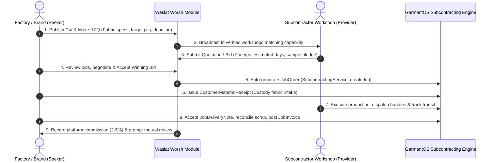
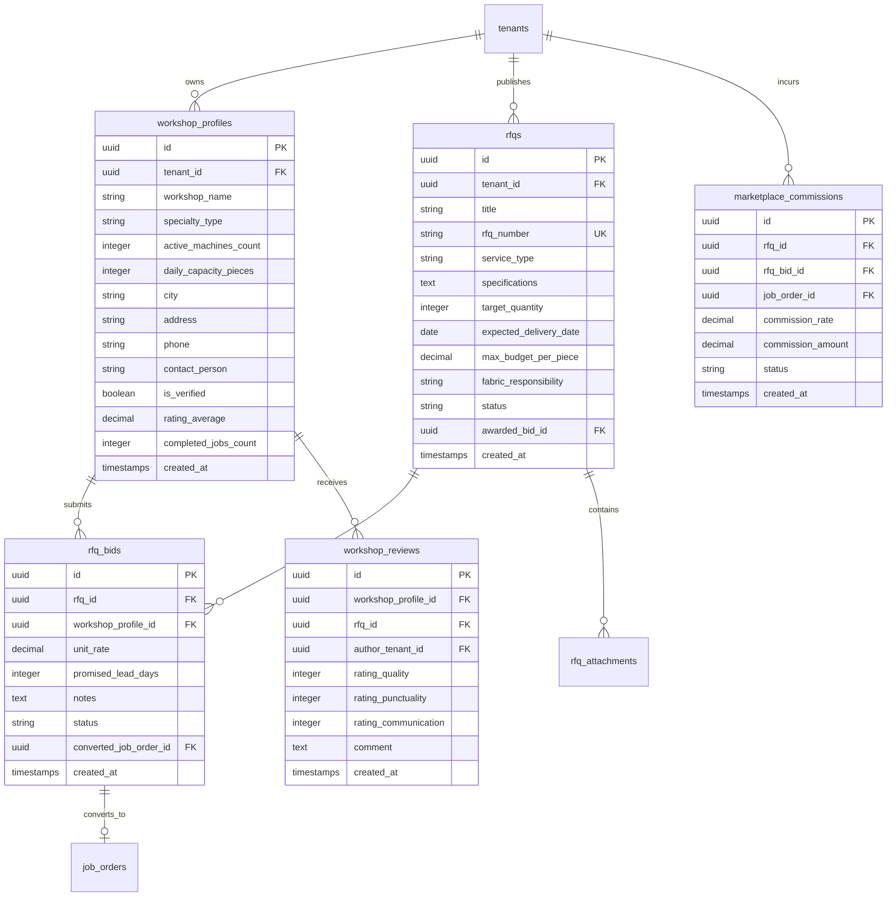

# Waslat Worsh (وصلة ورش) — Integrated B2B Industrial Marketplace Architecture

**Date:** October 31, 2026  
**Status:** Approved Module Architecture  
**Scope:** B2B Capacity Sourcing, RFQ Bidding, Workshop Profiles, Job Order Conversion & Commission Ledger

---

## 1. Overview & Dual-Journey Concept

**Waslat Worsh** is GarmentOS Cloud's integrated B2B manufacturing exchange. It bridges the gap between:
1. **Capacity Seekers (Garment Brands & Large Factories):** Apparel companies seeking reliable subcontractors for contract cutting, sewing overflow, pleating, embroidery, or full CMT jobs.
2. **Capacity Providers (Specialized Workshops & Independent Cutters):** Sewing ateliers, specialized embroidery units, and cutting rooms offering machinery, tables, and skilled labor.

Per **ADR-012** and **ADR-018**, Waslat Worsh is **not** an external portal. It is built directly into GarmentOS Cloud, seamlessly converting awarded bids into factory `JobOrder` records and isolating customer fabric custody through `SubcontractingService`.

---

## 2. The 2 Core Marketplace Journeys

---

## 3. Database Schema Design

---

## 4. Anti-Abuse, Moderation & Commission Lifecycle

1. **Anti-Collusion & Verification:** Workshop profiles must be verified by Platform Admins (`is_verified = true`) before bidding on high-volume commercial RFQs.
2. **Double-Counting Prevention:** An awarded `rfq_bid` stores `converted_job_order_id`. Any subsequent conversion attempt is rejected idempotently.
3. **Transparent Commission Engine:** On job confirmation, platform commissions (e.g. 2.5% of CMT labor value) are recorded in `marketplace_commissions` and billed on the tenant's monthly subscription invoice.
4. **Verified Ratings:** Only tenants who completed a genuine `JobDeliveryNote` on an awarded RFQ can submit a review.

