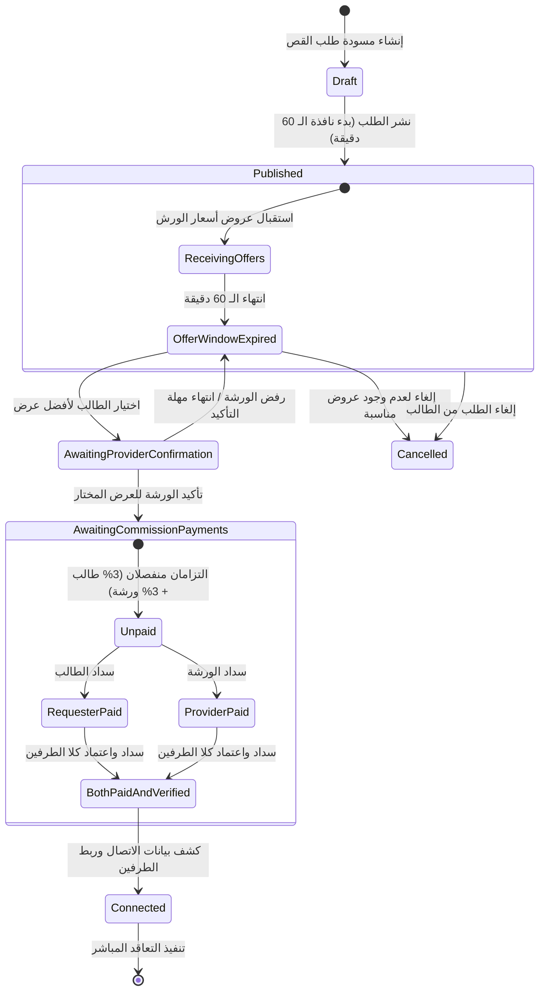

# وثيقة المواصفات المعمارية ودليل التشغيل لمنصة وصلة ورش الصناعية
# Waslat Worsh (وصلة ورش) — Premium-Tier Exclusive Cutting Marketplace

**التاريخ:** 4 نوفمبر 2026  
**الحالة:** تقرير تدقيق معتمد وخطة تنفيذ مرحلية (Architecture Audit & Implementation Plan)  
**النطاق:** سوق رقمي حصري لخدمات قص الملابس الجاهزة (Garment Cutting Services Marketplace)  
**نموذج الإيرادات:** عمولة متبادلة 3% لطالب الخدمة + 3% لمقدم الخدمة (إجمالي 6% للمنصة)  
**حصرية الاشتراك:** مقصورة حصرياً على كبرى المصانع والمجموعات في الباقة القصوى (`enterprise`)  

---

## 1. تقرير التدقيق المعماري والوضع الراهن (Architecture Audit Report)

### 1.1 الوظائف القائمة القابلة لإعادة الاستخدام (Existing Reusable Functionality)
1. **جداول الكيان الأساسية (`2026_10_31_000022_create_waslat_worsh_tables.php`):**
   - جدول ملفات تعريف الورش والمشاغل (`workshop_profiles`).
   - جدول طلبات عروض الأسعار (`rfqs`).
   - جدول عروض أسعار الورش (`rfq_bids`).
   - جدول عمولات المنصة (`marketplace_commissions`).
   - جدول تقييمات الجودة والالتزام (`workshop_reviews`).
2. **محرك التشغيل للغير والقص للغير (`SubcontractingService.php`):**
   - إنشاء أوامر التشغيل (`JobOrder`).
   - عزل ملكية الأقمشة وأمانات العملاء (`CustomerMaterialReceipt`).
3. **محرك الاشتراكات والحصص (`SubscriptionUsageService.php`):**
   - بنية الاشتراكات المتعددة للمستأجرين (`FactorySubscription`).
   - كتالوج الباقات القياسية الثلاث:
     - `starter`: باقة الورش والمشاغل (Sort Order: 1).
     - `pro`: باقة المصانع المتطورة (Sort Order: 2).
     - `enterprise`: باقة المجموعات الصناعية الكبرى (Sort Order: 3) — **الباقة الأعلى المؤهلة**.

---

### 1.2 أوجه القصور والتعارض الجوهري في التطبيق الحالي (Conflicting & Missing Functionality)

| المحور | الوضع الراهن في الكود | المتطلب التجاري الصارم (المستهدف) | نوع التعارض |
|---|---|---|---|
| **أهلية الاشتراك (Subscription Tier)** | المنصة متاحة لكافة الباقات (`starter`, `pro`, `enterprise`) ومحكومة فقط بعداد الحصص `marketplace_bids`. | **حصرية مطلقة للباقة القصوى (`enterprise`) فقط**. حظر تام للباقات الأدنى (`starter`, `pro`) على مستوى الـ Backend والـ Middleware والـ Frontend. | 🔴 تعارض جوهري حرج |
| **نافذة العروض والترسية (Offer Window)** | يمكن لطالب الخدمة قبول وترسية أي عرض فور تقديمه دون أي انتظار زمني. | **نافذة عروض إجبارية لمدة 60 دقيقة** محكومة بالخادم (`server-side`). يُمنع اختيار أي عرض قبل انقضاء الـ 60 دقيقة مع مؤقت عد تنازلي. | 🔴 تعارض تجاري حرج |
| **القبول المتبادل (Mutual Acceptance)** | الترسية فورية وأحادية الجانب من الطالب وتحول مباشرة إلى `JobOrder`. | **اعتماد متبادل على مرحلتين:** اختيار الطالب يضع العرض في `selected_pending_provider_confirmation`، ويلزم تأكيد صريح من مقدم الخدمة قبل أي التزام مالي. | 🔴 تعارض دورة حياة |
| **نموذج العمولات (Commissions)** | عمولة واحدة بنسبة 3% على الطالب فقط، والورشة لا تدفع أي عمولة. | **عمولة متبادلة بنسبة 3% على الطالب + 3% على مقدم الخدمة (إجمالي 6%)** مع التزامين ماليين مستقلين وسجل تدقيق غير قابل للتكرار. | 🔴 تعارض مالي جوهري |
| **حجب بيانات الاتصال (Anonymity & Contact Reveal)** | أرقام الهواتف وأسماء مسؤولي الورش معلنة للجميع في استعلامات الـ API العامة. | **حظر تام لكشف أي بيانات اتصال** (هاتف، واتساب، عنوان، اسم مسؤول) حتى سداد واعتماد عمولة الطرفين معاً وتأكيد القبول. | 🔴 خرق أمني وخصوصية |
| **تحقق مدفوعات إنستاباي (InstaPay Verification)** | حالة العمولة مجرد نص `pending` دون مسار دفع أو رفع إيصال أو تدقيق مالي. | **نظام سداد يدوي بإنستاباي للعمولة الخاصة بالمنصة**، مع رفع إيصالات مشفرة خاصة واعتماد يدوي من مسؤول المنصة المالي برقم مرجعي فريد. | 🟡 نقص وظائفي حاد |
| **مواصفات طلب القص الفنية** | بيانات عامة مقتضبة (`title`, `specifications`, `target_quantity`). | **نموذج قص متخصص متكامل:** الموديل الفني، خصائص القماش (نوع، وزن GSM، عرض، خيط، هالك)، توزيع المقاسات والألوان، وفرشات القص. | 🟡 نقص تفصيلي |
| **بوابة الموقع العام (Public Portal)** | التبويب متاح فقط داخل الـ ERP للمستخدمين المسجلين مسبقاً. | **واجهة عامة لـ "وصلة ورش" على موقع GarmentOS الرئيسي** تتيح استعراض الخدمة وتقديم الطلب مع التحقق من أهلية الحساب والاشتراك. | 🟡 نقص تكاملي |

---

## 2. مصفوفة قواعد الأعمال المعتمدة (Business Rules Matrix)

---

## 3. تفاصيل نموذج الأهلية للباقة القصوى (`enterprise`)

1. **معرف الميزة (Feature Entitlement Key):**
   `waslat_worsh_marketplace`
2. **شروط الأهلية التشغيلية:**
   - اشتراك المستأجر في باقة `enterprise` فقط (`plan_tier === 'enterprise'`).
   - حالة الاشتراك نشطة (`status === 'active'`).
   - اشتراك مسدد وغير منتهي الصلاحية (`is_paid === true` و `current_period_end > now()`).
3. **سياسة التعامل مع الباقات الأدنى (`starter`, `pro`):**
   - حجب التبويب بالكامل من قائمة التنقل.
   - إرجاع خطأ HTTP `403 Forbidden` برسالة واضحة: `UPGRADE_REQUIRED_ENTERPRISE`.
   - عرض شاشة ترقية مخصصة (Upgrade CTA Screen) تشرح مميزات سوق وصلة ورش لكبرى المجموعات والمصانع وتوجه إلى ترقية الباقة.
4. **حماية السجلات التاريخية:**
   - في حال تخفيض الباقة أو انتهاء صلاحيتها، يتم منع إنشاء أي طلبات أو عروض جديدة مع الحفاظ التام على السجلات التاريخية والعمولات المسجلة دون أي حذف.

---

## 4. نموذج العمولات المزدوجة (3% + 3% Dual Commission Model)

- **نسبة عمولة طالب الخدمة (Requester Commission):** 3.00% من إجمالي قيمة العرض المتفق عليه.
- **نسبة عمولة مقدم الخدمة (Provider Commission):** 3.00% من إجمالي قيمة العرض المتفق عليه.
- **إجمالي دخل المنصة (GarmentOS Platform Revenue):** 6.00%.
- **مثال مالي توضيحي:**
  - قيمة عرض القص المتفق عليه: **50,000 جنيه مصري**.
  - عمولة طالب الخدمة (3%): **1,500 جنيه مصري**.
  - عمولة مقدم الخدمة (3%): **1,500 جنيه مصري**.
  - إجمالي إيراد المنصة المكتسب: **3,000 جنيه مصري**.
- **طريقة السداد:** تحويل يدوي عبر تطبيق **InstaPay** على الحساب المالي المعتمد لإدارة المنصة، مع رفع صورة الإيصال للتحقق البشري من قِبل المدير المالي للمنصة (`platform_admin`).
- **حظر التحويل التجاري للقص:** المنصة لا تقبض ولا تضمن قيمة تشغيل أمر القص (50,000 جنيه)؛ حيث يُسوى هذا المبلغ مباشرة بين المصنعين بموجب اتفاقهم التجاري الخاص.

---

## 5. حدود المسؤولية القانونية (Platform Liability & Terms)

- منصة GarmentOS هي جهة ربط تقنية وسيطة (Technology Intermediary Marketplace).
- لا تقوم المنصة بعمليات القص المادية ولا تستلم الأقمشة ولا تضمن جودة التنفيذ أو أوقات التسليم أو التزامات التعاقد الخاص.
- يشترط النظام موافقة صريحة وموثقة ببصمة رقمية على شروط الوساطة وإخلاء المسؤولية قبل نشر أي طلب وقبل اعتماد كشف بيانات الاتصال.

---

## 6. خطة التنفيذ المرحلية (Staged Implementation Plan)

- **المرحلة B (تم إنجازها واختبارها بنسبة 100%):** تطبيق قيود الأهلية والصلاحيات للباقة القصوى (`enterprise`) ومحرك الصلاحيات.
- **المرحلة C (تم إنجازها واختبارها بنسبة 100%):** ترقية جدول وشاشات طلبات القص بمواصفات الأقمشة والملفات والموديلات وحجب الخصوصية.
- **المرحلة D:** محرك العروض ونافذة الـ 60 دقيقة الإجبارية المحكومة بالخادم مع المؤقت التفاعلي.
- **المرحلة E:** دورة حياة الاختيار والاعتماد المتبادل (`Mutual Acceptance`).
- **المرحلة F:** نظام العمولات المزدوجة وسداد InstaPay والتحقق الإداري المالي.
- **المرحلة G:** حجب بيانات الاتصال ونظام الكشف المشروط بالاعتماد الكامل.
- **المرحلة H:** لوحات تحكم الطالب والمقدم ولوحة إدارة المنصة والواجهة على الموقع العام.
- **المرحلة I:** الاختبارات الشاملة (Unit, Feature, Regression, Security, UI).

---

## 7. توثيق إنجاز المرحلة B (Stage B Implementation Record)

### 7.1 الملفات والتعديلات المنفذة
1. **الهجرة:** `2026_11_04_000031_seed_waslat_worsh_enterprise_feature_entitlement.php`
   - إضافة ميزة `waslat_worsh_marketplace` حصراً لمصفوفة `features` الخاصة بباقة `enterprise`.
   - تجريد باقتي `starter` و `pro` تماماً من هذه الميزة.
2. **محرك الاشتراكات المركزي (`SubscriptionUsageService.php`):**
   - تحديث `seedDefaultPlans()` لحصر الاستحقاق في `enterprise`.
   - إضافة دالة `hasFeatureEntitlement(string $tenantId, string $featureKey): array` للتحقق الشامل من:
     - وجود المستأجر وعدم تعليقه (`suspended`) أو إلغائه.
     - نشاط الاشتراك (`status === 'active'`) وسريان تاريخ الفترة الحالية وعدم انتهائها.
     - مطابقة الباقة مع كود `enterprise` واحتواء مصفوفة `features` على `waslat_worsh_marketplace`.
3. **وسيط الصلاحيات المركزي (`EnsureTenantHasMarketplaceEntitlement.php`):**
   - حظر كافة العمليات النشطة لغير المؤهلين برمز `403` وحمولة موحدة تحوي `WASLAT_WORSH_SUBSCRIPTION_REQUIRED`.
   - دعم نمط `read_or_history` للسماح للمستأجرين السابقين باستعراض سجلاتهم التاريخية فقط في وضع القراءة.
   - تسجيل الاسم المستعار `marketplace.entitled` في `bootstrap/app.php`.
4. **مسارات الـ API (`routes/api.php`):**
   - إضافة مسار فحص الأهلية المباشر: `GET /api/v1/waslat-worsh/eligibility`.
   - حماية مسارات القراءة بالوسيط `marketplace.entitled:read_or_history`.
   - حماية مسارات الإنشاء والترسية والعروض بالوسيط `marketplace.entitled:write`.
5. **واجهة المستخدم وتجربة الترقية (`WaslatWorshTab.tsx`):**
   - فحص الأهلية التلقائي عند التحميل وعرض شاشة ترقية فخمة ومخصصة لغير المؤهلين تشرح مزايا باقة Enterprise مع زر الترقية المباشر ورابط الانتقال للباقات.
   - تمكين أصحاب السجلات التاريخية من استعراض طلباتهم السابقة بوضع القراءة فقط مع شريط تحذيري.

### 7.2 نتائج الاختبارات وضمان الجودة
- **حزمة اختبارات الاستحقاق (`WaslatWorshSubscriptionEntitlementTest.php`):** 12 اختباراً بنجاح 100% (47 تأكيداً).
- **اختبارات التكامل لسوق وصلة ورش (`WaslatWorshIntegrationTest.php`):** 6 اختبارات بنجاح 100% (26 تأكيداً).
- **اختبارات القبول التجاري (`WaslatWorshCommercialAcceptanceTest.php`):** 4 اختبارات بنجاح 100% (30 تأكيداً).
- **بناء الفرونت إند (`tsc -b && vite build`):** نجاح تام دون أي أخطاء طباعية في 1.75 ثانية.

---

## 8. توثيق إنجاز المرحلة C (Stage C Implementation Record)

### 8.1 المكونات والتحسينات المنجزة
1. **هجرة قاعدة البيانات (`2026_11_04_000032_add_cutting_specifications_to_rfqs_table.php`):**
   - إضافة أعمدة المواصفات الفنية: `model_name`, `garment_model_id`, `garment_category`, `priority`, `fabric_details`, `production_details`, `logistics`, `attachments`, `published_at`, `terms_accepted_at`, `terms_version` مع فهرس خارجي لموديلات الملابس `garment_models`.
2. **تطوير النموذج ومحرك الخدمات (`Rfq.php` & `WaslatWorshService.php`):**
   - دعم كامل للتحويل الآلي لكافة هياكل البيانات `fabric_details`, `production_details`, `logistics`, `attachments` كمصفوفات JSON.
   - التحقق الصارم من اتساق تفصيل المقاسات وتفصيل الألوان مع إجمالي كمية الطلب `validateBreakdownConsistency`.
   - دورة حياة متكاملة للمسودة: إنشاء مسودة `createRfq`، تعديلها `updateRfq`، نشرها صراحة `publishRfq`، أو إلغاؤها `cancelRfq`.
   - حجب العناوين الدقيقة للمخازن وأرقام الهواتف لغير المالك في السوق `maskPrivateDetails`.
   - التخزين الآمن للمرفقات الفنية في `private/waslat_worsh/{tenantId}/rfqs/{rfqId}/` مع حظر كشف المسار الحقيقي والدفق الثنائي المشفر.
3. **واجهة المستخدم والعميل الشبكي (`apps/web`):**
   - نافذة إنشاء وتعديل طلب القص الفني المتقدم `CreateCuttingRequestModal.tsx`.
   - نافذة استعراض المواصفات الفنية والتحميل المباشر للمرفقات `CuttingRequestDetailsModal.tsx`.
   - ترقية لوحة وصلة ورش `WaslatWorshTab.tsx` لدعم فرز المسودات والطلبات المنشورة والشارات المتوافقة.
   - دوال العميل الشبكي المحدثة في `api.waslatWorsh` (`updateRfq`, `publishRfq`, `cancelRfq`, `uploadAttachment`, `deleteAttachment`).

### 8.2 نتائج الاختبارات والتحقق الآلي
- **حزمة اختبارات المرحلة C (`WaslatWorshStageCCuttingRequestTest.php`):** 11 اختباراً بنجاح 100% (53 تأكيداً برمجياً).
- **إجمالي اختبارات سوق وصلة ورش المجمعة:** 33 اختباراً بنجاح 100% (156 تأكيداً برمجياً).
- **بناء الفرونت إند (`npm run build`):** نجاح تام في 1.19 ثانية دون أي خطأ في فحص الأنواع أو التجميع.

---

## 9. توثيق إنجاز المرحلة C.1 — تكامل الموقع العام الخارجي (Stage C.1 Public Website Integration)

### 9.1 المكونات والواجهات المنجزة
1. **وحدة التحكم العامة بالخلفية (`WaslatWorshPublicController.php`):**
   - تعمل خارج وسيط التوثيق `auth:sanctum` ووسيط المستأجرين `identify.tenant`.
   - خاضعة لمعدل تدفق الحماية `throttle:public-storefront` (60 طلب/دقيقة).
   - توفر 3 نقاط نهاية عامة وآمنة:
     - `GET /api/v1/waslat-worsh/public/rfqs`: استعراض مفهرس للطلبات المنشورة فقط `status in ('published', 'open')` مع الفلترة حسب المحافظة وفئة الملابس وكلمات البحث.
     - `GET /api/v1/waslat-worsh/public/rfqs/{id}`: استعراض تفصيلي آمن للطلب مع حجب تام للعناوين الخاصة وأرقام الهواتف وتفاصيل المستأجر الداخلية، وتوليد 404 فوري لأي طلب ملغي أو مسودة.
     - `GET /api/v1/waslat-worsh/public/metrics`: إحصائيات ونشاط حي محسوب برمجياً من قاعدة البيانات (عدد الطلبات النشطة، إجمالي القطع المطلوبة، عدد المحافظات المغطاة، عدد فئات الملابس النشطة).
2. **عزل البيانات الصارم وحماية الخصوصية:**
   - الحقول المسموحة (Allowlist) فقط هي ما يتم إرجاعه للزوار.
   - حجب تام للمرفقات الفنية ومسارات التخزين الخاصة بها ورسوم الباترون؛ حيث تظهر للجمهور مؤشرات إحصائية فقط (`has_pattern_file`, `attachments_count`, `attachment_types`) مع علامة حظر `requires_enterprise_auth`.
   - عزل تام لعروض الأسعار (Bids) وأسماء المستأجرين وأرقام حساباتهم.
3. **تكامل واجهة المستخدم والتوجيه العام (`apps/web`):**
   - صفحة عامة متكاملة وغنية `WaslatWorshPublicPage.tsx` عند المسار `/#/waslat-worsh` وتدعم الأسماء المستعارة `/#/cutting-marketplace` و `/#/worsh`.
   - زر بارز في القائمة العلوية الرئيسية (Desktop Navigation) مع شارة `B2B / بورصة القص`.
   - رابط فوري في القائمة الجانبية للهواتف الذكية (Mobile Navigation Drawer).
   - قسم ترويجي وتعريفي مميز على الصفحة الرئيسية للموقع العام يربط الزوار بالسوق وبباقة Enterprise.
   - رابط مخصص في التذييل العام للموقع (Public Page Footer) ضمن عمود الحلول الصناعية.
   - نافذة تفاصيل عامة آمنة `PublicRfqDetailsModal` لشرح مواصفات الطلب الفنية دون كشف هوية المالك.
   - قسم تفاعلي للأسئلة الشائعة (FAQ Accordion) ومسارات التسجيل والترقية للباقة المؤسسية Enterprise.

### 9.2 نتائج الاختبارات والتحقق الآلي
- **حزمة اختبارات المرحلة C.1 (`WaslatWorshStageC1PublicWebsiteTest.php`):** 10 اختبارات بنجاح 100% (57 تأكيداً برمجياً).
- **إجمالي اختبارات سوق وصلة ورش المجمعة (المراحل B و C و C.1):** 43 اختباراً بنجاح 100% (213 تأكيداً برمجياً دون أي إخفاق).
- **فحص الأنواع البرمجية (`tsc -b`):** 0 أخطاء بنجاح تام.
- **بناء إنتاج الفرونت إند (`vite build`):** نجاح تام دون أي أخطاء في 1.61 ثانية.

