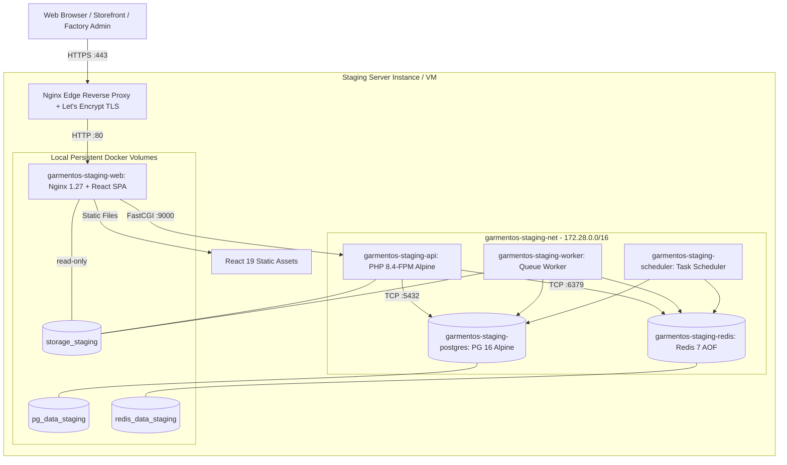

# GarmentOS Cloud — Staging Architecture & Infrastructure Design

**Document Version:** 1.0.0-staging  
**Creation Date:** 2026-11-16  
**Repository:** `keroulsg/clothes`  
**Target Baseline SHA:** `d9516cbedac4c59f5a613ea5107854d431ce48e7`  
**Target Environment:** Isolated Pre-Production Staging (`staging.garmentos.com`)

---

## 1. Executive Summary & Objective

The Staging environment represents a complete, production-identical, multi-tenant replica of GarmentOS Cloud. Its primary mission is to:
1. Provide a realistic PostgreSQL 15/16 engine to execute and validate multi-process concurrency and transactional locking tests (`PostgresConcurrencyIntegrationTest.php`).
2. Provide an isolated testbed for external factory owners, workshop managers, and apparel brand stakeholders to perform live User Acceptance Testing (UAT).
3. Validate real Redis queuing, automated task scheduling, S3-compatible attachment uploads, and Let's Encrypt TLS termination without exposing live production data or risking customer operations.

---

## 2. Infrastructure Audit & Codebase Realities

Based on direct inspection of the repository source code and configuration files:

### 2.1 Laravel Runtime & PHP Engine
- **Framework:** Laravel 13.17 (`apps/api/composer.json: "laravel/framework": "^13.17"`).
- **PHP Version:** PHP 8.4 CLI & FPM (Runtime base: `php:8.4-fpm-alpine`).
- **Required PHP Extensions:**
  - `pdo_pgsql` & `pgsql`: Native PostgreSQL driver.
  - `bcmath`: Required for high-precision financial calculations, piece-rate wages, and commission computations.
  - `intl`: Required for multi-lingual formatting (Arabic RTL / English LTR) and Egyptian Pound (EGP) currency output.
  - `gd` (with freetype & jpeg): Product catalog image resizing and receipt thumbnail generation.
  - `zip`: Archive packaging for export reports and backup manifests.
  - `opcache`: Bytecode caching for low latency ($<50\text{ms}$ API response targets).
  - `pcntl`: POSIX signal handling for graceful queue worker shutdowns.
  - `redis` (PECL 6.1.0): High-performance C client for Redis.

### 2.2 PostgreSQL Database & Extensions
- **Engine:** PostgreSQL 15.6+ or 16.2+ Alpine.
- **Character Encoding:** `UTF-8` with collation `en_US.UTF-8` or `C.UTF-8`.
- **Required Extensions:**
  - `uuid-ossp` or `pgcrypto`: Primary keys throughout the entire database schema are UUID v4 (`Schema::create(..., $table->uuid('id')->primary())`).
  - `advisory_locks`: Native transactional advisory locking (`pg_try_advisory_xact_lock`) used in concurrency control tests.
- **Connection Configuration:** Configured in `apps/api/config/database.php` under `'pgsql'`. Supports connection pooling and SSL modes (`prefer` / `require`).

### 2.3 Redis Cache, Queue & Session Broker
- **Engine:** Redis 7.2+ Alpine.
- **Persistence Mode:** Append-Only File (`--appendonly yes`) to guarantee zero job loss across container restarts.
- **Security:** Password-protected (`--requirepass ${REDIS_PASSWORD}`) and bound strictly to the private network.
- **Key Partitioning:**
  - Cache: DB 0 (`CACHE_STORE=redis`)
  - Queues: DB 1 (`QUEUE_CONNECTION=redis`)
  - Sessions: DB 2 (`SESSION_DRIVER=redis`)

### 2.4 Queue Workers & Scheduling
- **Queue Worker Daemon:** Supervised worker executing:
  ```bash
  php artisan queue:work redis --queue=high,default,notifications --sleep=3 --tries=3 --max-time=3600 --memory=256
  ```
  - Priority Queues: `high` (payment approvals, order state transitions), `default` (standard jobs), `notifications` (SMS, emails).
- **Scheduler:** Supervised daemon executing `php artisan schedule:work` every minute. Responsible for automated daily backups (`garmentos:backup`), cache hygiene, and subscription expiration checks.
- **Horizon & Reverb Assessment:**
  - `laravel/horizon` is **not installed** in `composer.json`. Workers are managed cleanly via Supervisord / Docker container processes.
  - `laravel/reverb` is **not installed** in `composer.json`. Real-time notifications operate via polling and standard REST API state updates.

### 2.5 Object Storage (S3-Compatible)
- **Current Status:** `apps/api/config/filesystems.php` contains the S3 disk configuration using environment variables `AWS_ACCESS_KEY_ID`, `AWS_SECRET_ACCESS_KEY`, `AWS_BUCKET`, `AWS_ENDPOINT`.
- **Identified Dependency Gap:** `league/flysystem-aws-s3-v3` is **not installed** in `apps/api/composer.json`.
  > [!IMPORTANT]
  > **Technical Prerequisite:** Before setting `FILESYSTEM_DISK=s3`, the package `league/flysystem-aws-s3-v3` must be installed. For local/containerized Staging without external cloud accounts, the shared persistent volume `garmentos_storage` with `FILESYSTEM_DISK=local` remains 100% operational.

### 2.6 Frontend Static Asset Hosting
- **Stack:** React 19, TypeScript, Vite 6.2/8.3, TailwindCSS.
- **Build Output:** Compiled static bundle in `apps/web/dist/` (HTML, CSS, JS chunks).
- **Web Server:** Nginx 1.27 Alpine serving static files directly with cache headers (`max-age=31536000, immutable` for `/assets/`, `no-store` for `index.html`) and reverse-proxying `/api/` to `api:9000`.

---

## 3. Staging Network & Container Architecture

The Staging environment utilizes a fully decoupled multi-container topology isolated inside a private Docker bridge network (`garmentos-staging-net`, CIDR `172.28.0.0/16`):



### 3.1 Network Isolation & Access Restrictions
1. **Public Ingress:** Ports `80` (HTTP redirect) and `443` (HTTPS) are the **only** open ports on the host machine.
2. **Database Isolation:** PostgreSQL (port `5432`) is bound strictly to `garmentos-staging-net`. No host port mapping (`0.0.0.0:5432`) is permitted.
3. **Redis Isolation:** Redis (port `6379`) is bound strictly to `garmentos-staging-net` and protected with an authentication password.
4. **Backend FastCGI:** PHP-FPM (port `9000`) is accessible only to the `web` container.
5. **Non-Root Execution:** All application containers execute as limited system users (`www-data` uid 82/1000 or `nginx` uid 101).

---

## 4. Staging Service Dependencies Matrix

| Service | Container Name | Base Image | Required Memory | Storage Volume | Health Check Probe |
| :--- | :--- | :--- | :---: | :--- | :--- |
| **Edge Proxy** | `garmentos-edge` | `nginx:1.27-alpine` | 128 MB | Host TLS Certs | `wget --spider http://127.0.0.1/` |
| **Web Frontend** | `garmentos-staging-web` | Custom Nginx SPA | 256 MB | `storage_staging` (ro) | `wget --spider http://127.0.0.1/` |
| **API Backend** | `garmentos-staging-api` | Custom PHP 8.4-FPM | 512 MB | `storage_staging` (rw) | `cgi-fcgi -bind -connect 127.0.0.1:9000` |
| **Queue Worker** | `garmentos-staging-worker` | Custom PHP 8.4-CLI | 256 MB | `storage_staging` (rw) | `php artisan queue:monitor redis:default` |
| **Scheduler** | `garmentos-staging-scheduler` | Custom PHP 8.4-CLI | 128 MB | `storage_staging` (rw) | Process heartbeat probe |
| **Database** | `garmentos-staging-postgres` | `postgres:16-alpine` | 1024 MB | `pg_data_staging` | `pg_isready -U garmentos_staging` |
| **Cache/Queue**| `garmentos-staging-redis` | `redis:7-alpine` | 256 MB | `redis_data_staging` | `redis-cli -a $REDIS_PASSWORD ping` |

**Total Staging Server Sizing Recommendation:**
- **CPU:** 2 to 4 vCPUs.
- **RAM:** 4 GB minimum (8 GB recommended for concurrent load testing).
- **SSD Storage:** 50 GB NVMe SSD.
