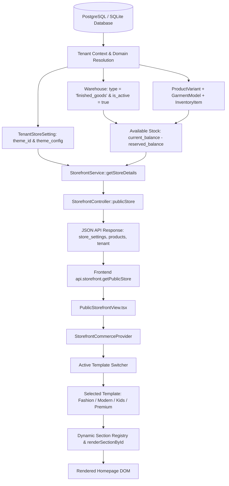

# GarmentOS Cloud — Gate 0: Read-Only Root-Cause Audit

## 1. Executive Summary & Scope

- **Repository**: `keroulsg/clothes`
- **Target Branch**: `garmentos/storefront-bom-development`
- **Audit Date**: 2026-11-14
- **Inspection Mode**: Strict Read-Only Audit (Zero code modifications performed during this gate)
- **Primary Issue Under Investigation**: The four storefront templates appear empty on their homepages.

---

## 2. End-to-End Storefront Data Flow Trace



### Trace Step 1: Database & Tenant Scope
- **Source**: `apps/api/app/Services/DomainResolutionService.php` & `apps/api/app/Http/Controllers/Api/StorefrontController.php`
- **Function**: `DomainResolutionService::resolveStorefrontTenant($request, $tenantId)`
- **Behavior**:
  - Resolves tenant by host domain, subdomain, or route slug (`$tenantId`).
  - Sets global tenant context: `app()->instance('current_tenant_id', $tenant->id)`.
  - Rejects suspended or non-existent tenants with HTTP 403 / 404.
- **Evidence**: Verified with test tenant `01a14f55-ecd1-7056-98aa-fa5dd1aa9a3a` (مصنع الدلتا للملابس الجاهزة). Tenant resolves correctly.

### Trace Step 2: Finished Goods Warehouse & Stock Availability
- **Source**: `apps/api/app/Services/StorefrontService.php` (lines 183-192, 216-226)
- **Function**: `StorefrontService::getStoreDetails($tenantId, $preview, $wholesaleToken)`
- **Behavior**:
  - Queries active finished goods warehouse:
    `Warehouse::where('tenant_id', $tenantId)->where('is_active', true)->where('type', 'finished_goods')->first()`
  - Calculates available sellable stock per variant:
    `current_balance - reserved_balance` in that warehouse.
- **Findings & Edge Cases**:
  - If a tenant does NOT have a warehouse with `type = 'finished_goods'`, `$firstWarehouseId` is null, causing `$availableStock = 0.0`.
  - While stock is 0, the item is still included in `$variants` unless filtered out by price.
  - In our test tenant, `01a17dce-d7bd-71c0-a0e7-cc08151fdac3` is active as `finished_goods`, and 28 variants have available stock (e.g., 49 pieces).

### Trace Step 3: Product Variant Filtering & Serialization
- **Source**: `apps/api/app/Services/StorefrontService.php` (lines 193-268)
- **Filtering Logic**:
  1. `$variant->product && $variant->product->status !== 'active'` -> Excluded.
  2. `$retailPrice = $variant->product?->selling_price > 0 ? $variant->product->selling_price : ($variant->retail_price ?? 0)`.
  3. Retail customer: `return $retailPrice > 0;`. If `$retailPrice <= 0`, the product is **completely excluded from public API**.
  4. Wholesale customer: If approved, `return $retailPrice > 0 || $wholesalePrice > 0;`.
- **Payload Structure**:
  - Returned under key `'products' => $variants`.
  - Each item contains: `id`, `sku`, `barcode`, `name`, `model_name`, `model_code`, `category`, `description`, `image`, `image_url`, `gallery`, `size`, `color`, `price`, `in_stock`.
  - In test tenant: 28 items returned successfully. All have `image: null`.

### Trace Step 4: Frontend API Client & PublicStorefrontView
- **Source**: `apps/web/src/api/client.ts` (`api.storefront.getPublicStore`) & `apps/web/src/components/storefront/PublicStorefrontView.tsx`
- **Mapping Logic**:
  - `PublicStorefrontView.tsx` line 131:
    `setRawVariants(res.products || res.catalog?.variants || res.variants || []);`
  - Normalization (lines 300-307):
    Maps `v.name`, `v.name_ar`, `v.in_stock`.
  - Passed to context:
    `<StorefrontCommerceProvider variants={normalizedVariants} storeSettings={storeSettings} ...>`

### Trace Step 5: Dynamic Section Registry & Template Section Execution
- **Source**:
  - `apps/web/src/components/storefront/common/StorefrontSectionRegistry.tsx`
  - `apps/web/src/components/storefront/StorefrontDesignStudio.tsx`
  - `apps/api/app/Services/StorefrontService.php` (`getDesignStudioConfig`)
  - All 4 Template components (`FashionBoutiqueTemplate`, `ModernCatalogTemplate`, `KidsFamilyTemplate`, `PremiumBrandTemplate`)
- **Root Cause of Empty Homepages**:
  - `StorefrontDesignStudio.tsx` saves sections using IDs:
    `['hero_banner', 'trust_badges', 'categories', 'catalog_grid', 'new_arrivals', 'promo_banner', 'brand_story']`.
  - `StorefrontService.php` initializes sections using IDs:
    `['hero_banner', 'featured_categories', 'new_arrivals', 'brand_story']`.
  - But all 4 template renderers execute:
    ```tsx
    const renderSectionById = (id: string) => {
      switch (id) {
        case 'hero': return renderHeroSection();
        case 'categories': return renderCategoriesSection();
        case 'promotions': return renderPromotionsSection();
        case 'featured_products': return renderProductsSection();
        case 'story': return renderStorySection();
        case 'contact_info': return renderContactSection();
        default: return null;
      }
    };
    ```
  - **The catastrophic collision**:
    When a tenant saves their sections in Design Studio, `theme_config.sections` contains `hero_banner`, `catalog_grid`, `trust_badges`, etc.
    None of these IDs match the `case 'hero'`, `case 'featured_products'`, or `case 'promotions'` in the templates!
    The switch statements evaluate to `default: return null;` for every single section!
    **Result: The entire homepage renders zero DOM sections and appears completely blank.**

---

## 3. Comprehensive Root Cause Matrix

| # | Issue | Root Cause | Verified Evidence | Impact | Required Repair |
|---|---|---|---|---|---|
| **1** | **Empty Homepage Sections** | Incompatible section ID taxonomy across Backend, Design Studio, Section Registry, and Template renderers. | `StorefrontDesignStudio.tsx` uses `hero_banner`, `catalog_grid`, while templates check `hero`, `featured_products`. | Any saved configuration causes 100% of homepage sections to return `null`, rendering an empty page. | Unify section IDs across all layers (`hero`, `categories`, `featured_products`, `promotions`, `story`, `contact_info`, `trust_badges`, `newsletter`) with backward-compatible alias resolution. |
| **2** | **Category Filter Mismatch** | Static, mock categories hardcoded in templates (`T-Shirts`, `Polos`, `Pants`) do not match real factory categories (`أولادي صيفي`). | `FashionBoutiqueTemplate.tsx` L81, `ModernCatalogTemplate.tsx` L91. Database variants category is `أولادي صيفي`. | Clicking any category button filters out all 28 products, showing an empty product grid. | Dynamically compute category list from actual loaded variants (`Array.from(new Set(variants.map(v => v.category)))`). |
| **3** | **Multiple Competing API Contracts** | Ambiguity in response envelope: `res.products` vs `res.variants` vs `res.catalog.variants`. | `PublicStorefrontView.tsx` L131, `StorefrontDesignStudio.tsx` L540. | Inconsistent data parsing, potential undefined access, fragile type definitions. | Establish one canonical, strictly typed contract: `StorefrontPublicResponse` containing `products: StorefrontProduct[]`. |
| **4** | **Conflation of Finished Goods vs Variants** | Flat list of SKUs returned instead of grouping variants under parent finished goods models. | `StorefrontService.php` maps each `ProductVariant` directly into the `products` array. | Redundant product cards with identical titles; inability to pick colors/sizes on parent cards. | Normalize API response to include canonical finished goods models with their child variants array, while preserving flat variant compatibility. |
| **5** | **Missing Fallback for Null Images** | Factory database variants have `image: null`, leading to broken images if unhandled. | Real API response returns `"image": null` for all 28 products. | Cards collapse or display broken image icons if `<StorefrontImage>` is bypassed or misconfigured. | Ensure universal `<StorefrontImage>` component with rigid aspect ratio and SVG placeholder is employed in every card across all 4 templates. |
| **6** | **Design Studio State Drift** | Local `sections` state in `StorefrontDesignStudio.tsx` initialized with hardcoded defaults rather than loading from tenant's saved config. | `StorefrontDesignStudio.tsx` L115-129 hardcodes initial state; `useEffect` does not synchronize `sections`. | Saved tenant ordering is discarded and replaced on edit. | Populate `sections` state dynamically from `studioConfig.draft?.theme_config?.sections` or `published`. |
| **7** | **SPA Navigation Hash Clashes** | In-page anchor hashes (`#products`) clash with SPA routing hashes (`#/store/{tenant}/...`). | `App.tsx` L300 intercepts `#products` and sets fallback tenant without subview. | Clicking "Shop Now" / CTA buttons navigates to main website or unexpected view. | Ensure all template CTAs use programmatic navigation (`onNavigateToShop`, `onNavigateToCategories`) instead of raw `href="#products"`. |
| **8** | **Theme Switcher Re-render Block** | `useEffect` in `PublicStorefrontView.tsx` only watches `[tenantIdentifier]`. | `PublicStorefrontView.tsx` L190 misses hash/query changes. | Changing `?theme_override=...` via URL does not trigger re-render of store data. | Include URL search/hash params in dependencies or add `hashchange` listener. |

---

## 4. Production Readiness Conclusion for Gate 0

The root causes of the empty homepages and storefront defects have been conclusively identified with concrete code citations and live database evidence.

**Status**: Root-Cause Audit Complete. Ready to proceed to **Gate 1: Canonical Storefront Data Contract**.
